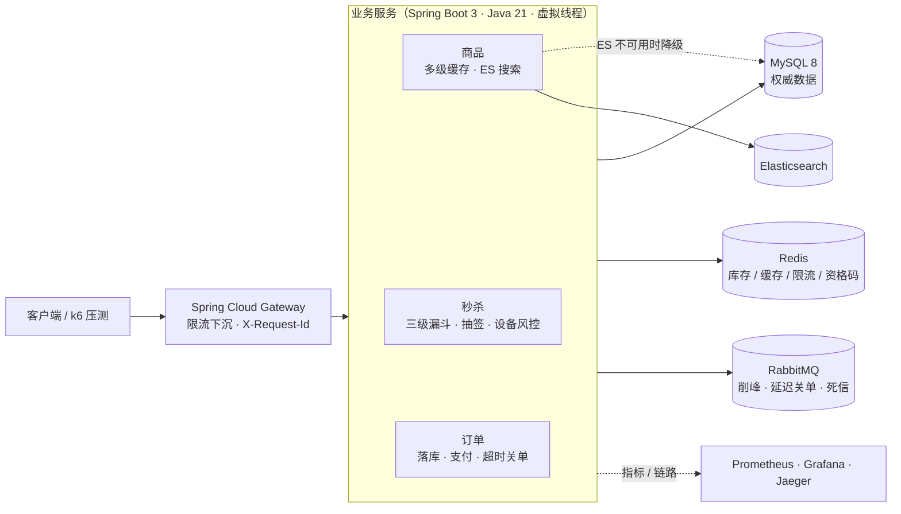
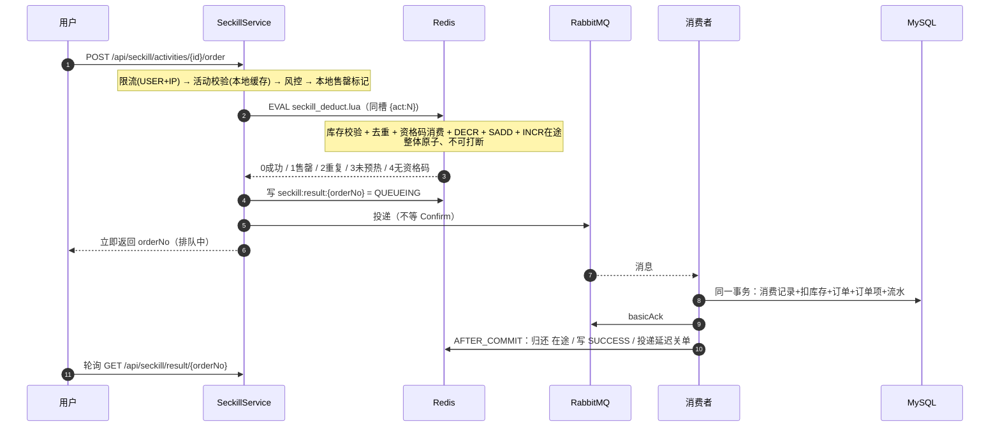

# 高并发秒杀系统 · 商品 + 秒杀

> **一句话定位**：把「瞬时数万请求、而数据库只能扛几千」的秒杀场景，做成一套**可运行、可压测、可自证**的工程方案——
> 三级漏斗挡掉 99.9% 的流量，数据库约束兜住最后一道，最终一致性由对账任务自动收敛。

<p>
<a href="https://github.com/adfddda/high-concurrency-mall/actions/workflows/ci.yml"></a>


</p>

---

## 系统全景



**四条不能违反的规则**（它们决定了上面每个箭头的方向）：

| 规则 | 体现 |
|---|---|
| **数据库是权威，Redis 是可重建投影** | 对账永远把 Redis 对齐到 DB，而不是反过来 |
| **消息负责"快"，扫描任务负责"不漏"** | 延迟关单 + 每分钟兜底扫描；消息 Confirm + 超时重投 |
| **不确定时选择可恢复的那一侧** | 宁可少卖（可对账修复），绝不超卖（资损） |
| **降级必须是显式的** | ES 挂了走 DB 但记 WARN；限流挂了 fail-open 并计数 |

---

## 系统规模

| 维度 | 规模 |
|---|---|
| REST 接口 | **31** 个（认证 / 商品 / 秒杀 / 订单 / 运维可观测） |
| 数据表 | **10** 张，唯一索引 + `CHECK` 约束兜底 |
| Redis Lua 脚本 | **5** 个（扣减 / 回补 / 在途回收 / 滑动窗口 / 令牌桶） |
| 代码规模 | **9,674** 行 Java（业务 7,820 + 测试 1,854）+ 网关 359 |
| 自动化测试 | **84** 个（79 业务 + 5 网关），含 800 并发不超卖、MQ 全挂演练 |
| 单机吞吐 | **13,102 QPS**，服务端平均 **1.118 ms/请求** |

---

## 一分钟看懂这个项目

### 它解决的核心矛盾

秒杀的本质矛盾是：**瞬时并发达数万，而数据库只能承受数千**。
天真的做法（每个请求直接扣库存）会让数据库在几十毫秒内被打挂。

本项目的答案是**三级漏斗**，把 99.9% 的流量挡在数据库之外：

```
  ① 本地内存判断      →  几纳秒    挡掉：活动未开始/已结束、本实例已知售罄
  ② Redis Lua 原子扣减 →  亚毫秒    挡掉：库存不足、重复购买、无资格码
  ③ MySQL 条件更新     →  毫秒级    兜底：唯一索引 + CHECK 约束，绝不超卖
         ↓
      只有 ① ② 都通过的请求，才会异步落库
```

### 四个"不只是能用"的设计

| 设计 | 天真的做法 | 本项目的做法 |
|---|---|---|
| **不超卖** | Redis `DECR` 后判断是否 < 0 | 库存校验 + 扣减 + 一人一单 + 资格码消费 + 在途计数，**一个 Lua 原子完成**；DB 侧 `CHECK` + 唯一索引兜底 |
| **消息不丢不重** | 发出去就不管 | Confirm + Return + 超时扫描三路兜底；三层幂等（消息/订单/流水唯一索引）；死信先查订单状态再决定是否回补 |
| **一致性** | 更新 DB 后删缓存 | `AFTER_COMMIT` + 延迟双删 + 短 TTL 本地缓存；**明确承认最长 3 秒的不一致窗口** |
| **故障可自愈** | 靠人工修复 | 对账任务用"**在途计数泄漏探测**"发现并修复库存漂移，覆盖进程崩溃、代码 bug 等补偿逻辑够不到的情况 |

---

## 核心链路



> 完整架构图、缓存读取链路、MQ 拓扑见 **[docs/01-architecture.md](docs/01-architecture.md)**。

### 实测数据速览

| 结论 | 证据 |
|---|---|
| **不超卖** | 800 虚拟线程抢 200 库存 → 成功数**恰好 200**、剩余库存**恰好 0**（自动化测试，非估算） |
| **缓存真的挡住了数据库** | 10 万请求压商品详情：**L1 命中 99.9%、L2 0.1%、数据库 0 次访问** |
| **MQ 挂掉不会丢库存** | RabbitMQ 完全不可用 + 2 万并发秒杀请求 → 5 个活动**全部 `drift = 0`、在途归零** |
| **吞吐** | 单机自压 **13,102 QPS**（客户端与服务端争抢 CPU，此值为**下界**）；服务端平均 1.118ms/请求 |
| **退出登录即刻生效** | 退出后**同一个 JWT 立刻失效**，而不是等 2 小时自然过期 |

> ⚠️ 一个方法论上的坑：首版用 Python 压测只测到 738 QPS，而服务端自测平均只要 1.68ms
> ——**瓶颈全在压测客户端的 GIL 上**。改用 Java 虚拟线程后同机同接口测到 13,102 QPS。
> 详见 [docs/04-benchmark.md](docs/04-benchmark.md)。

---

## 秒杀的三种形态

同一个"抢"字，在三种场景下有不同的正确解法。**它们是可配置的，不是三套代码**。

### ① 直接抢：拼手速

`mode = 0`。限流 → 风控 → Redis 原子扣减 → MQ 异步落库，接口立即返回"排队中"。

### ② 预约抽签：把 10 万次抢购变成 200 次扣减

`mode = 1`。直接抢购有个绕不开的问题：10 万人抢 200 件，**99.8% 的请求注定失败**，
但它们依然要穿过网关、限流器、Redis Lua。

```text
① 预约（活动开始前，可分散到几小时/几天）
        ↓
② 开奖（后台批处理，与用户请求完全解耦）
        ↓
③ 中签者凭资格码下单 —— 进入扣减链路的请求量 ≈ 库存量级
```

**资格码为什么放 Redis 而不是只放数据库**：下单是热路径，回查会**把数据库又放回秒杀链路**。
码同步到 Redis 集合后，扣减 Lua 用 `SREM` 在**同一个原子操作**里完成"校验 + 消费"：

```lua
if mode == '1' then
    if redis.call('SREM', codesKey, qualifyCode) == 0 then
        return 4   -- 无资格 / 已被使用
    end
end
```

因此同一个码**不可能**被用两次。另外库存检查放在消费资格码**之前**：
中签者来晚一步时得到的是"售罄"而不是"无资格"，资格码不会被白白吃掉。

### ③ 设备风控：限流挡"量"，风控挡"人"

限流挡不住"一台设备、100 个账号、轮流点"——每个账号都合法、每次请求都在限额内。

```text
请求 → 活动校验 → 设备风控（只读检查）→ Lua 扣减 → 成功后占用设备名额
                       │
                       └─ 命中 → 审计落库 + 直接拒绝
```

两个关键取舍：

1. **检查只读、成功后才标记**：检查时就写入会把"已售罄"的失败请求也消耗掉设备名额，
   等于**没抢到还把你拉黑**；
2. **设备号可选**：拿不到指纹就放行（IP 限流兜底）——宁可漏防，也不能因为客户端老旧误杀正常用户。

> 拦截记录落在 `t_seckill_risk_hit`，`/api/admin/seckill/{id}/risk-hits` 可按原因统计。

### 库存分桶：单 key 热点的解法（可选）

单个活动的库存是一个天然热点 key：Redis Cluster 下它只落在一个分片上，
**该分片的单线程能力就是整个活动的吞吐上限**，加分片也救不了。

`SECKILL_BUCKETS > 1` 时把库存拆成 N 个桶，按 `floorMod(hash(userId), N)` 路由，
每个桶用自己的 Hash Tag `{act:N:bK}`——**桶之间落在不同槽**，因此能分散到不同分片。

三个必须说清楚的代价：

1. 同一用户永远落同一个桶（这是"一人一单"和"资格码"能在桶内原子判定的前提），
   所以**桶间负载由哈希决定，不可控**；
2. **不做跨桶回退**：你的桶卖完就返回售罄，即使别的桶还有货——会少卖，但绝不会超卖；
3. **单机 Redis 上分桶没有吞吐收益**（仍然是一个线程），收益只在 Cluster 下出现。

> 默认 `bucket-count=1`，行为与不分桶完全一致；`BucketedSeckillTest` 用 4 桶
> 验证了「800 并发抢 200 件，成功数恰好 200」。**我没有把没跑过的性能数字写进 README。**

---

## 接入层：为什么要有网关

```text
客户端 ──► 网关 :8081 ──► 业务服务 :8080
             │
             ├─ 每 IP / 每窗口固定窗口限流（Redis INCR+PEXPIRE，fail-open）
             ├─ 透传/生成 X-Request-Id
             └─ 业务服务不再直接对公网开放
```

**两层限流的分工**（不是二选一）：

| 层 | 粒度 | 算法 | 目的 | 代价 |
|---|---|---|---|---|
| 网关 | IP + 路径前缀 | 固定窗口（`INCR` + `PEXPIRE`） | 挡住脚本与爬虫，在进入业务进程之前 | 边界突刺，可能放过 2 倍流量 |
| 业务服务 | 用户 / 接口 | 滑动窗口 / 令牌桶（Lua） | 精确业务配额，与库存逻辑同进程 | 一次 Redis 往返，占用业务线程 |

---

## 可观测性：能看见，才谈得上优化

`docker compose --profile full up -d` 之后：

| 入口 | 地址 | 用途 |
|---|---|---|
| **Grafana** | http://localhost:3000 | admin/admin，看板 `Mall Overview` 已自动装载 |
| Prometheus | http://localhost:9090 | 原始指标 |
| Jaeger | http://localhost:16686 | 链路追踪：HTTP → MQ → 消费端 |
| Swagger UI | http://localhost:8081/swagger-ui.html | 接口文档，可直接调试 |

看板里的 8 个面板各自回答一个问题：秒杀结果分布（流量卡在哪层）、缓存层级命中（DB 线应为 0）、
Lua P99（Redis 是否瓶颈）、Hikari pending（连接池是否打满）、限流拒绝、吞吐/延迟/JVM。

> 指标不是"装个 Grafana 就有了"。这个项目每个关键设计都对应一个可观测信号：
> 缓存命中率、Lua 耗时、MQ 事件、库存漂移、风控拦截——**没有信号的设计等于没有设计**。

---

## 5 分钟跑通全链路

> 想一次看完整条链路（登录 → 浏览 → 搜索 → 抢购 → 轮询结果 → 设备风控 → 抽签 → 对账），
> 直接跑 **`python scripts/demo.py`**（只用标准库，无需安装依赖）。下面是可以逐条复制的原始命令。

```bash
# 1. 注册 / 登录
curl -X POST localhost:8080/api/auth/register -H 'Content-Type: application/json' \
     -d '{"username":"lxt","password":"123456"}'
TOKEN=$(curl -s -X POST localhost:8080/api/auth/login -H 'Content-Type: application/json' \
     -d '{"username":"lxt","password":"123456"}' | jq -r .data.token)

# 2. 商品（第一次回源 DB，第二次命中 L1）
curl localhost:8080/api/product/detail/1001
curl localhost:8080/api/product/detail/1001

# 3. 预热活动后抢购
curl -X POST localhost:8080/api/seckill/activities/2001/preheat -H "Authorization: Bearer $TOKEN"
curl -X POST localhost:8080/api/seckill/activities/2001/order \
     -H "Authorization: Bearer $TOKEN" -H "X-Device-Id: demo-device-1"
# → {"code":0,"data":{"orderNo":"SO...","status":"QUEUEING"}}

# 4. 轮询结果（也可以通过 MQ 异步落库后直接查订单）
curl localhost:8080/api/seckill/result/SO... -H "Authorization: Bearer $TOKEN"

# 5. 对账：Redis 与数据库是否一致
curl localhost:8080/api/admin/seckill/reconcile -H "Authorization: Bearer $TOKEN"
```

前置要求与端口：

| 组件 | 宿主机端口 | 说明 |
|---|---|---|
| MySQL | 3307 | root / root123456 |
| Redis | 6380 | 无密码 |
| RabbitMQ | 5672 / **15672** | mall / mall123456 |
| 应用 | 8080 | |
| 网关 | **8081** | full profile |
| Prometheus / Grafana / Jaeger / ES | 9090 / 3000 / 16686 / 9200 | full profile |

```bash
docker compose up -d                          # 只起中间件
docker compose --profile full up -d --build   # 中间件 + 应用 + 网关 + 观测栈
```

---

## 工程结构

```
gateway/                独立部署的 API 网关（自己的 pom，与业务服务解耦）
deploy/k8s/             Kubernetes 清单（Deployment / Service / HPA）
scripts/                demo.py / k6 压测 / bench 客户端
src/main/java/com/lxt/mall/
├── auth/          JWT 签发解析、Redis 黑名单、登录与管理员拦截器
├── product/       商品服务与缓存读写
├── cache/         多级缓存：Caffeine + Redis + 布隆过滤器 + 互斥重建
├── seckill/       秒杀核心：主流程 / 库存 Lua 封装 / 预热 / 补偿 / 对账 / 抽签 / 风控
├── order/         订单落库事务、状态机、超时关单
├── mq/            可靠发送、投递跟踪、幂等台账
├── job/           对账 / 预热 / 超时兜底 / 投递补偿 / 开奖
├── admin/         运维可观测接口
├── metrics/       Micrometer 业务埋点
├── search/        ES 索引与降级搜索
├── ratelimit/     @RateLimit + Lua 限流
├── common/        统一响应、异常、上下文、Redis Key 规范
├── config/        各类配置与 MallProperties
└── domain/        实体 / 枚举 / Mapper
```

---

## 测试与 CI

- **84 个测试**：79 个业务（并发/幂等/状态机/缓存/限流/抽签/风控/分桶/接口契约）+ 5 个网关
- **CI 三个 job**：`mvn verify`（起真实 MySQL / Redis / RabbitMQ / **Elasticsearch**）、Docker 镜像、网关构建
- **集成测试用真中间件**，不用 H2 / embedded-redis——本项目一半的价值在"和真中间件打交道的行为"

```bash
mvn test                 # 需要本地中间件（或 docker compose up -d）
python scripts/demo.py   # 端到端演示
k6 run scripts/k6/seckill.js
```

---

## 文档索引

| 文档 | 内容 | 什么时候看 |
|---|---|---|
| **[01-架构](docs/01-architecture.md)** | 分层架构、秒杀时序图、缓存链路、MQ 拓扑、故障矩阵 | 想快速理解全局 |
| **[02-关键设计决策](docs/02-key-design.md)** | 21 个非平凡选择的**备选方案对比 + 代价** | 想知道"为什么这么设计" |
| **[03-面试题库](docs/03-interview-qa.md)** | 百余道题，结合本项目的答案 + 追问 + 防御方式 | 准备面试 |
| **[04-压测报告](docs/04-benchmark.md)** | 实测 QPS / 延迟分位 / 缓存命中 / MQ 故障演练 | 想看数据 |
| **[05-踩坑记录](docs/05-pitfalls.md)** | 13 个真实踩到的坑，含定位过程与反思 | **面试最能加分** |
| **[06-简历描述](docs/06-resume.md)** | STAR 结构的项目描述 + 可能的追问方向 | 写简历 |
| **[07-业务流程](docs/07-business-flows.md)** | 按板块讲"一个请求进来发生了什么" | 读源码前先看 |
| **[11-数据库设计](docs/11-database-design.md)** | 逐表讲清楚键、约束、读写场景 | 想理解数据模型 |
| **[12-加固记录](docs/12-hardening.md)** | **11 个"测试全绿但逻辑确实错了"的缺陷**：怎么发现、为什么危险 | **体现工程严谨性** |
| **[13-扩容与演进](docs/13-scaling-and-evolution.md)** | 分库分表与 Canal 同步的可执行设计（标注"未实现"） | 被问"怎么扩容" |
| **[14-运维手册](docs/14-runbook.md)** | 告警阈值、应急开关、故障处置剧本 | 被问"怎么运维" |

> 更早的版本（含交易域/购物车/优惠券/拼团）保留在 git tag **`v2-full`**：
> `git checkout v2-full` 可随时查看。

---

## 已知边界与后续演进

| 现状 | 生产级演进方向 |
|---|---|
| 单机 Redis | Redis Cluster（Hash Tag 已就绪）+ **库存分桶已实现**（`SECKILL_BUCKETS`，默认 1） |
| 缓存失效靠应用层 | 接 **Canal 订阅 binlog** → 方案见 [13-扩容与演进](docs/13-scaling-and-evolution.md)，未实现 |
| 多实例 L1 不一致 | 用 Redis Pub/Sub 广播失效，或交给 Canal；当前靠 3 秒 TTL 收敛 |
| 秒杀消息台账在内存 | 换成 **Redis 台账 / 本地消息表（Outbox）** |
| 无分库分表 | 订单按 `user_id` 分片 → 方案见 [13](docs/13-scaling-and-evolution.md)，未实现 |
| 链路追踪只到进程级 | 已接入 OpenTelemetry + Jaeger |
| 未做全链路压测 | 用 k6 做分布式压测，排除压测机瓶颈 |
