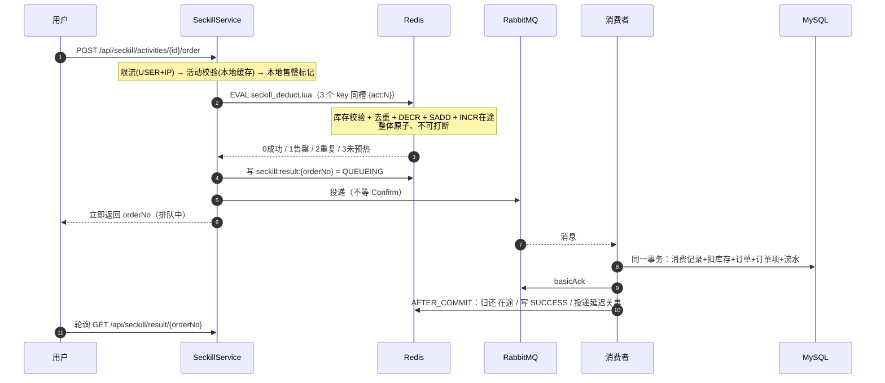
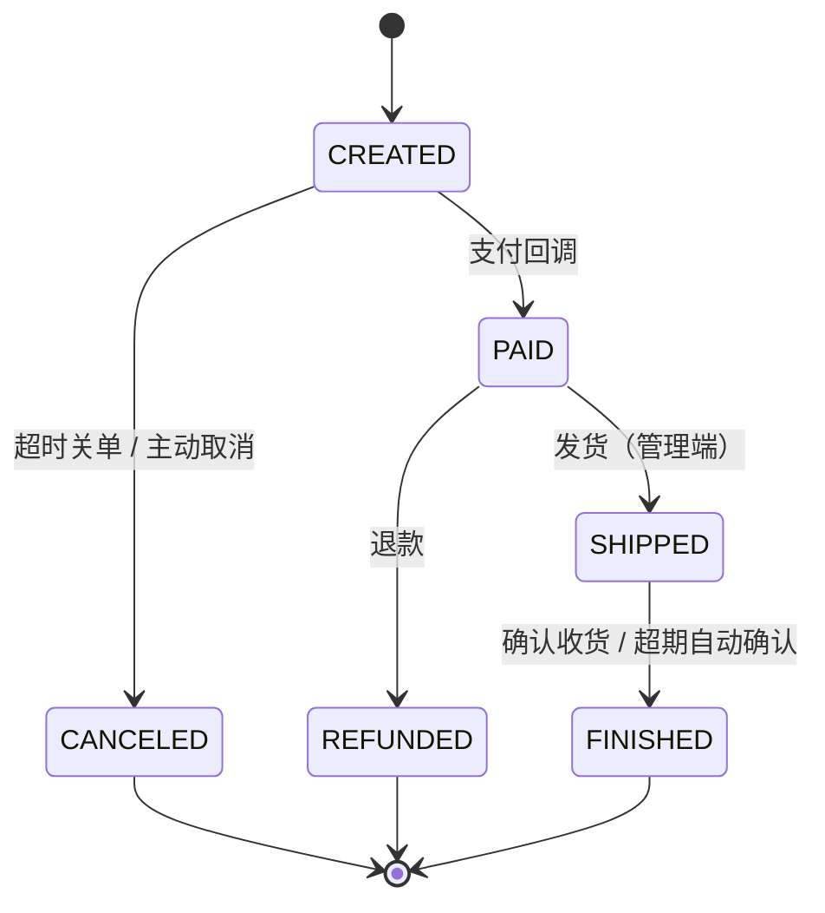

# 分布式交易系统 · 秒杀 / 库存一致性 / 可靠消息

> **一句话定位**：把「瞬时数万请求、而数据库只能扛几千」的秒杀场景，做成一套**可运行、可压测、可自证**的工程方案——
> 三级漏斗挡掉 99.9% 的流量，数据库约束兜住最后一道，最终一致性由对账任务自动收敛。

<p>
<a href="https://github.com/adfddda/high-concurrency-mall/actions/workflows/ci.yml"></a>


</p>

---

## 系统规模

| 维度 | 规模 |
|---|---|
| REST 接口 | **47** 个（认证 / 商品 / 秒杀 / 交易 / 订单 / 运维可观测） |
| 数据表 | **17** 张，唯一索引 + `CHECK` 约束兜底 |
| Redis Lua 脚本 | **5** 个（扣减 / 回补 / 在途回收 / 滑动窗口 / 令牌桶） |
| 代码规模 | **7,098** 行 Java（主代码 + 测试）+ **6,927** 行设计文档 |
| 自动化测试 | **88** 个用例（业务）+ **1**（网关），含 800 并发不超卖、MQ 全挂演练 |
| 单机吞吐 | **13,102 QPS**，服务端平均 **1.118 ms/请求** |

---

## 一分钟看懂这个项目

### 它解决的核心矛盾

秒杀的本质矛盾是：**瞬时并发达数万，而数据库只能承受数千**。
天真的做法（每个请求直接扣库存）会让数据库在几十毫秒内被打挂。

本项目的答案是**三级漏斗**，把 99.9% 的流量挡在数据库之外：

```
  ① 本地内存判断      →  几纳秒    挡掉：活动未开始/已结束、本实例已知售罄
  ② Redis Lua 原子扣减 →  亚毫秒    挡掉：库存不足、重复购买
  ③ MySQL 条件更新     →  毫秒级    兜底：唯一索引 + CHECK 约束，绝不超卖
         ↓
      只有 ① ② 都通过的请求，才会异步落库
```

### 四个"不只是能用"的设计

| 设计 | 天真的做法 | 本项目的做法 |
|---|---|---|
| **不超卖** | Redis `DECR` 后判断是否 < 0 | 库存校验 + 扣减 + 一人一单 + 在途计数，**一个 Lua 原子完成**；DB 侧 `CHECK` + 唯一索引兜底 |
| **消息不丢不重** | 发出去就不管 | Confirm + Return + 超时扫描三路兜底；三层幂等（消息/订单/流水唯一索引）；死信先查订单状态再决定是否回补 |
| **一致性** | 更新 DB 后删缓存 | `AFTER_COMMIT` + 延迟双删 + 短 TTL 本地缓存；**明确承认最长 3 秒的不一致窗口** |
| **故障可自愈** | 靠人工修复 | 对账任务用"**在途计数泄漏探测**"发现并修复库存漂移，覆盖进程崩溃、代码 bug 等所有补偿逻辑够不到的情况 |

---

## 核心链路



> 完整架构图、缓存读取链路、MQ 拓扑见 **[docs/01-architecture.md](docs/01-architecture.md)**。

### 实测数据速览

| 结论 | 证据 |
|---|---|
| **不超卖** | 800 虚拟线程抢 200 库存 → 成功数**恰好 200**、剩余库存**恰好 0**（自动化测试，非估算） |
| **缓存真的挡住了数据库** | 10 万请求压商品详情：**L1 命中 99.9%、L2 0.1%、数据库 0 次访问** |
| **MQ 挂掉不会丢库存** | RabbitMQ 完全不可用 + 2 万并发秒杀请求 → 5 个活动**全部 `drift = 0`、在途归零** |
| **吞吐** | 单机自压 **13,102 QPS**（客户端与服务端争抢 CPU，此值为**下界**）；服务端平均 1.118ms/请求 |
| **退出登录即刻生效** | 退出后**同一个 JWT 立刻失效**，而不是等 2 小时自然过期 |

> ⚠️ 一个方法论上的坑：首版用 Python 压测只测到 738 QPS，而服务端自测平均只要 1.68ms
> ——**瓶颈全在压测客户端的 GIL 上**。改用 Java 虚拟线程后同机同接口测到 13,102 QPS。
> 详见 [docs/04-benchmark.md](docs/04-benchmark.md)。

---

## 接入层：为什么要有网关

```text
客户端 ──► 网关 :8081 ──► 业务服务 :8080
             │
             ├─ 每 IP / 每窗口限流（Redis 计数，多副本共享配额）
             ├─ 透传/生成 X-Request-Id
             └─ 业务服务不再直接对公网开放
```

**两层限流的分工**（不是二选一）：

| 层 | 粒度 | 算法 | 目的 | 代价 |
|---|---|---|---|---|
| 网关 | IP + 路径前缀 | 固定窗口（`INCR` + `PEXPIRE`） | 挡住脚本与爬虫，在进入业务进程之前 | 边界突刺，可能放过 2 倍流量 |
| 业务服务 | 用户 / 接口 | 滑动窗口 / 令牌桶（Lua） | 精确业务配额，与库存逻辑同进程 | 一次 Redis 往返，占用业务线程 |

> 网关用固定窗口是**刻意**的：它的定位是粗粒度保护，成本必须极低。
> 真正的精确限流留在业务侧——**不要用同一个精度的方案去解决两个层次的问题**。

---

## 快速开始

### 前置要求

| 组件 | 版本要求 | 说明 |
|---|---|---|
| JDK | **21+** | 用到了虚拟线程、`record`、模式匹配 `switch` |
| Maven | 3.9+ | |
| MySQL | **8.0.16+** | `CHECK` 约束需要 8.0.16 才真正生效 |
| Redis | **6.0+**（推荐 7.x） | ⚠️ 5.x 不支持部分语法，详见 [踩坑记录](docs/05-pitfalls.md) |
| RabbitMQ | 3.9+ | 需要 `x-dead-letter-exchange` 与队列级 TTL |
| Docker | 可选 | 一键起中间件 |

### 方式一：Docker Compose 一键起全套（推荐）

```bash
# 只起中间件（MySQL 3307 / Redis 6380 / RabbitMQ 5672+15672）
docker compose up -d

# 中间件 + 应用一起起
docker compose --profile full up -d --build
```

宿主机端口刻意错开默认值，避免和你本机已装的 MySQL(3306)、Redis(6379) 冲突。

| 服务 | 宿主机端口 | 容器内端口 | 账号 |
|---|---|---|---|
| MySQL | 3307 | 3306 | root / root123456 |
| Redis | 6380 | 6379 | 无密码 |
| RabbitMQ | 5672 / **15672**(控制台) | 同 | mall / mall123456 |
| 应用 | 8080 | 8080 | — |
| 网关 | **8081** | 8080 | 对外入口（full profile） |

```bash
java -jar target/high-concurrency-mall.jar --spring.profiles.active=docker
```

### 方式二：用本机已有的中间件

```bash
# 1. 建库
mysql -uroot -p -e "CREATE DATABASE mall_trade DEFAULT CHARACTER SET utf8mb4;"

# 2. 起应用（local profile 会自动建表并灌演示数据）
mvn clean package -DskipTests
java -jar target/high-concurrency-mall.jar --spring.profiles.active=local
```

配置全部支持环境变量覆盖：

```bash
DB_HOST=localhost DB_PORT=3306 DB_USER=root DB_PASSWORD=123456 \
REDIS_HOST=localhost REDIS_PORT=6379 \
RABBIT_HOST=localhost RABBIT_PORT=5672 RABBIT_USER=mall RABBIT_PASSWORD=mall123456 \
java -jar target/high-concurrency-mall.jar
```

### 演示账号

应用启动时会自动创建（`mall.demo.seed-enabled=true`）：

| 用户名 | 密码 | 说明 |
|---|---|---|
| `lxt` | `123456` | 主演示账号 |
| `malluser1` ~ `malluser200` | `123456` | 压测用的批量账号（一人一单需要大量不同用户） |

> ⚠️ **生产环境必须把 `mall.demo.seed-enabled` 设为 `false`**，否则等于开了一个已知密码的后门。

---

## 5 分钟跑通全链路

```bash
BASE=http://127.0.0.1:8080

# ① 登录拿 token
TOKEN=$(curl -s -X POST $BASE/api/auth/login \
  -H 'Content-Type: application/json' \
  -d '{"username":"lxt","password":"123456"}' | jq -r .data.token)

# ② 看活动（公开接口）
curl -s "$BASE/api/seckill/activities?status=1" | jq '.data[] | {id,productTitle,seckillPrice,availableStock}'

# ③ 预热活动到 Redis（把库存和快照推进去）
curl -s -X POST "$BASE/api/seckill/activities/2001/preheat" -H "Authorization: Bearer $TOKEN"

# ④ 抢购
curl -s -X POST "$BASE/api/seckill/activities/2001/order" \
  -H "Authorization: Bearer $TOKEN" | jq

# ⑤ 轮询结果
curl -s "$BASE/api/seckill/result/{上一步返回的orderNo}" -H "Authorization: Bearer $TOKEN" | jq

# ⑥ 查订单 / 支付
curl -s "$BASE/api/order/list" -H "Authorization: Bearer $TOKEN" | jq
curl -s -X POST "$BASE/api/order/{orderNo}/pay" -H "Authorization: Bearer $TOKEN" | jq

# ⑦ 观察内部状态（面试演示的关键）
curl -s "$BASE/api/admin/seckill/2001/redis-state" -H "Authorization: Bearer $TOKEN" | jq
curl -s "$BASE/api/admin/seckill/reconcile"     -H "Authorization: Bearer $TOKEN" | jq
curl -s "$BASE/api/admin/cache/product/stats"   -H "Authorization: Bearer $TOKEN" | jq
curl -s "$BASE/api/admin/mq/pending"            -H "Authorization: Bearer $TOKEN" | jq
```

---

## 接口一览

### 认证 `/api/auth`

| 方法 | 路径 | 鉴权 | 限流 | 说明 |
|---|---|---|---|---|
| POST | `/register` | ✗ | — | 注册（BCrypt 存密） |
| POST | `/login` | ✗ | 令牌桶 10 容量 / 0.5 每秒（IP） | 登录，返回 JWT |
| POST | `/logout` | ✓ | — | 退出，jti 进黑名单（TTL = 剩余有效期） |
| GET | `/me` | ✓ | — | 当前用户 |

### 商品 `/api/product`

| 方法 | 路径 | 鉴权 | 限流 | 说明 |
|---|---|---|---|---|
| GET | `/list` | ✗ | — | 分页列表 |
| GET | `/search` | ✗ | 50/s（IP+API） | **商品搜索**（ES 优先，不可用时降级数据库） |
| GET | `/detail/{id}` | ✗ | 50/s（IP+API） | **多级缓存主战场**，响应带 `source` 字段标明 L1/L2/DB |
| POST | `/` | ✓ | — | 新增商品 |
| PUT | `/{id}` | ✓ | — | 更新商品（触发 AFTER_COMMIT 缓存失效） |

### 秒杀 `/api/seckill`

| 方法 | 路径 | 鉴权 | 限流 | 说明 |
|---|---|---|---|---|
| GET | `/activities` | ✗ | — | 活动列表 |
| GET | `/activities/{id}` | ✗ | — | 活动详情（含服务端时间，供前端校准倒计时） |
| POST | `/activities/{id}/order` | ✓ | **5/s（USER + IP 双维度）** | **抢购主入口**（抽签带 `qualifyCode`，可带 `X-Device-Id` 头） |
| POST | `/activities/{id}/reservation` | ✓ | — | 预约（仅抽签活动，幂等） |
| GET | `/activities/{id}/reservation` | ✓ | — | 我的预约结果（中签时返回资格码） |
| GET | `/result/{orderNo}` | ✓ | — | 轮询抢购结果 |
| POST | `/activities/{id}/preheat` | ✓ | — | 手动预热 |

### 交易 `/api/trade`（普通下单，与秒杀形成对照）

| 方法 | 路径 | 鉴权 | 说明 |
|---|---|---|---|
| GET | `/skus` | ✗ | 商品的可售 SKU 列表 |
| POST | `/orders` | ✓ | **普通下单（同步事务扣 SKU 库存，可叠加优惠券）** |
| GET/POST | `/cart` | ✓ | 查看 / 加购（幂等累加，单 SKU 封顶 99） |
| PUT/DELETE | `/cart/{skuId}` | ✓ | 改数量 / 删除 |
| GET | `/coupons` | ✓ | 我的优惠券（未使用 / 已使用 / 已过期） |
| POST | `/coupons/{templateId}/claim` | ✓ | 领券（限量，重复领取幂等） |
| POST | `/group-buy` | ✓ | 开团（3 人成团，24h 有效） |
| POST | `/group-buy/{groupId}/join` | ✓ | 参团 |
| GET | `/group-buy/{groupId}` | ✓ | 团详情（进度 / 成员 / 状态） |
| POST | `/orders/{orderNo}/pay` | ✓ | 发起支付，创建支付单（一个订单只允许一笔） |
| POST | `/payment/callback` | 验签 | 渠道回调：幂等 + 金额校验 |
| POST | `/orders/{orderNo}/refund` | ✓ | 全额退款，三层幂等 |

> **为什么同一个项目里有两套下单链路？**
> 秒杀要的是吞吐：Redis 预扣 + MQ 削峰，代价是用户要轮询结果。
> 普通下单要的是确定性：条件 UPDATE 扣库存 + 同步落库，点一下就能看到订单号。
> **按场景选架构，而不是把高并发方案套到所有写链路上**——这是这两条链路放在一起的意义。

**优惠券与库存是同一类问题**：限量 1000 张券 ≈ 限量 200 件货，都用
`UPDATE ... WHERE issued_count < total_count` 的条件更新发券；
核销用 `WHERE status = 0 AND user_id = ?` 保证一张券只能进一笔订单；
退款/取消用 `order_no` 反查把券还回去。三个动作各一条 SQL，没有分布式锁。

### 订单状态机



**每一次迁移都是「带前驱状态的 UPDATE」，靠影响行数判断竞争结果**：

```sql
UPDATE t_order SET status = 5, ship_time = ?
 WHERE order_no = ? AND status = 1   -- 只有 PAID 能被发货
```

这样「用户点确认收货」和「定时任务自动确认」同时发生时，只有一个能改到行。
不需要分布式锁，也不会出现"完成了两次"导致的重复结算。

### 拼团：成团判定只能发生一次

```text
开团 → 参团（各自生成待支付订单，库存已扣）
        ↓ 每笔支付成功
   成员状态 0→1（条件更新，谁改到行谁才有资格推进团）
        ↓
   团 paid_count+1，够了就置为"已成团"
        ↓ 到期仍未凑满
   团置为"已失败" → 未付的关单、已付的退款、库存全部回补
```

两个容易写错的地方：

1. **`SET` 子句的顺序**：MySQL 会把已赋值的列用在后续表达式里，
   必须先用旧的 `paid_count` 判断是否成团、再自增。写反了会永远差一人成团，
   而且不报错——只在测试里断言 `paid_count` 才能发现。
2. **失败处理不能吞异常**：成员处理失败必须让整批回滚、团回到"进行中"重试。
   如果吞掉异常继续，团会被置为"已失败"但有人没退到款，而"已失败"的团
   不会被再次扫描——**这笔钱就永远挂在平台上了**。

> 退款与关单本身都是幂等的（退款单唯一键 + 订单状态机），所以重试是安全的。

### 风控：限流挡"量"，风控挡"人"

限流按 IP/用户限速，能挡住"一个人狂点"和"一个 IP 打爆"。
但真实黄牛是**一台设备、100 个账号、轮流点**——每个账号都合法、每次请求都在限额内，
限流完全拦不住，只能靠设备指纹收敛。

```text
请求 → 活动校验 → 设备风控（只读检查）→ Redis Lua 扣减 → 成功后才占用设备名额
                        │
                        └─ 命中 → 记审计 + 直接拒绝（连 Lua 都不用走）
```

两个关键取舍：

1. **检查与标记分离**：检查是只读的，只有"扣减成功"才占用设备名额。
   如果检查时就写入，一个"已售罄"的失败请求会把设备烧掉——**没抢到还把你拉黑**。
2. **设备号是可选参数**：拿不到指纹时放行（靠 IP 限流兜底）。
   宁可漏防一部分，也不能因为客户端老旧就把正常用户全部拒之门外。

> 拦截记录落在 `t_seckill_risk_hit`，`/api/admin/seckill/{id}/risk-hits` 可按原因统计——
> 这是风控唯一能自证"到底挡住了多少"的证据。

### 抽签模式：把 10 万次抢购变成 200 次扣减

直接抢购有个绕不开的问题：10 万人抢 200 件，**99.8% 的请求注定失败**，
但它们依然要穿过网关、限流器、Redis Lua，最后拿到一句"已售罄"。
这些流量消耗的是真金白银，却没有任何业务价值。

抽签把它拆成两段：

```text
① 预约（活动开始前，可分散到几小时/几天）
        ↓
② 开奖（后台批处理，与用户请求完全解耦）
        ↓
③ 中签者凭资格码下单 —— 进入扣减链路的请求量 ≈ 库存量级
```

**资格码为什么放 Redis 而不是只放数据库**：下单是热路径，如果每次都要回查
`t_seckill_reservation`，等于把数据库又放回了秒杀链路。码同步到 Redis 集合后，
扣减 Lua 可以用 `SREM` 在**同一个原子操作**里完成"校验 + 消费 + 扣库存"——

```lua
if mode == '1' then
    if redis.call('SREM', codesKey, qualifyCode) == 0 then
        return 4   -- 无资格 / 已被使用
    end
end
```

因此同一个码**不可能**被用两次。另外库存检查放在消费资格码**之前**：
中签者来晚一步时得到的是"售罄"而不是"无资格"，资格码不会被白白吃掉。

> 数据模型见 `t_seckill_reservation`（`uk_activity_user` 去重 + `uk_qualify_code` 全局唯一）。

### 订单 `/api/order`

| 方法 | 路径 | 鉴权 | 说明 |
|---|---|---|---|
| GET | `/{orderNo}` | ✓（校验归属） | 订单详情 |
| GET | `/list` | ✓ | 我的订单 |
| POST | `/{orderNo}/pay` | ✓ | 模拟支付（条件更新，重复回调会被拒） |
| POST | `/{orderNo}/confirm` | ✓（校验归属） | 确认收货（`SHIPPED → FINISHED`） |
| POST | `/{orderNo}/cancel` | ✓ | 主动取消并回补库存 |

| 方法 | 路径 | 鉴权 | 说明 |
|---|---|---|---|
| GET | `/v3/api-docs` | ✗ | OpenAPI 3 规范（JSON） |
| GET | `/swagger-ui.html` | ✗ | Swagger UI，右上角 Authorize 填 token 即可调试 |

> 生产环境应整体关闭这两个端点（`springdoc.api-docs.enabled=false`），
> 而不是只靠拦截器——接口文档会把系统内部结构完整暴露出去。

### 运维可观测 `/api/admin`

> ⚠️ 需要**管理员身份**（`mall.admin.usernames` 白名单，默认 `lxt`）。
> 这些接口能改写 Redis 库存、触发对账修复，属于高危操作，普通登录用户一律 403。

| 方法 | 路径 | 说明 |
|---|---|---|
| GET | `/cache/product/stats` | L1 命中率统计 |
| GET | `/seckill/{id}/redis-state` | Redis 侧库存 / 在途 / 已购人数 / 本地售罄标记 |
| GET | `/seckill/reconcile` | **库存对账：Redis vs DB 是否一致** |
| GET | `/mq/pending` | 待确认投递数量（>0 说明 broker 或网络有问题） |
| POST | `/orders/{orderNo}/ship` | **发货**（`PAID → SHIPPED`），管理端专用 |
| GET | `/seckill/{id}/risk-hits` | 风控拦截统计（按原因分组） |

---

## 压测

项目里有**两个**压测客户端，请按场景选择：

| 脚本 | 说明 |
|---|---|
| **`scripts/BenchClient.java`** | **推荐**。Java 21 虚拟线程，单文件免编译（`java scripts/BenchClient.java`）。压测客户端自身不是瓶颈 |
| `scripts/smoke-test.py` | 端到端冒烟：健康检查 → 缓存三级链路 → 穿透防护 → 预热 → 秒杀 → 库存对账 |
| `scripts/load-test.py` | Python 版压测（易读、便于改），但**受 GIL 限制，高并发下客户端会成为瓶颈** |

```bash
# ============ 场景一：容量压测（应用以 benchmark profile 启动，限流关闭）============
java -jar target/high-concurrency-mall.jar --spring.profiles.active=benchmark

# 商品详情多级缓存（看数据来源分布，而不是只看 QPS）
java scripts/BenchClient.java --mode=cache \
     --concurrency=400 --requests=100000 --users=100

# 秒杀下单（需 RabbitMQ 就绪）
java scripts/BenchClient.java --mode=seckill \
     --activity-id=2001 --concurrency=400 --requests=50000 --users=500

# ============ 场景二：限流验证（应用以 local profile 启动，限流开启）============
java -jar target/high-concurrency-mall.jar --spring.profiles.active=local
java scripts/BenchClient.java --mode=seckill \
     --activity-id=2005 --concurrency=200 --requests=5000 --users=200
#    预期：大量 42900（被限流）

# ============ 场景三：端到端冒烟（任何时候都能跑）============
python scripts/smoke-test.py
```

> ⚠️ **报 QPS 之前先证明瓶颈不在压测客户端。**
> 读服务端自己统计的指标即可验证：`curl localhost:8080/actuator/metrics/http.server.requests`，
> 用 `TOTAL_TIME / COUNT` 算服务端平均延迟。如果它远小于客户端观测到的延迟，
> 那这个 QPS 就是客户端能力的上限。
> 本项目实测：Python 客户端 738 QPS（服务端仅 1.68ms/请求）→ 改用 Java 虚拟线程后 **13,102 QPS**，同机同接口。

> 📊 完整实测数据、故障演练与偏差说明见 **[docs/04-benchmark.md](docs/04-benchmark.md)**。

---

## 测试

```bash
mvn test
```

**43 个用例，全部通过。** 最有分量的几个：

| 测试 | 验证什么 |
|---|---|
| `SeckillStockConcurrencyTest#concurrentDeductNeverOversells` | **800 并发抢 200 库存 → 成功数恰好 200，Redis 库存恰好 0** |
| `SeckillStockConcurrencyTest#oneUserCanOnlyBuyOnce` | 同一用户 500 并发 → 只有 1 次成功 |
| `SeckillStockConcurrencyTest#rollbackIsCappedByTotalStock` | 重复回补 5 次，库存被总库存封顶，不会凭空造出库存 |
| `RedisRateLimiterTest#slidingWindowIsAtomicUnderConcurrency` | 200 并发打 limit=20 → 恰好放行 20 个 |
| `OrderIdempotencyTest#duplicateMessageCreatesOnlyOneOrder` | 同一消息消费两次 → 只产生一个订单，库存只扣一次 |
| `OrderIdempotencyTest#databaseRefusesNegativeStock` | 绕过应用层直接 `UPDATE` 扣成负数 → 被 `CHECK` 约束拒绝 |
| `OrderTimeoutTest#cancelIsIdempotent` | 重复关单 4 次 → 库存只回补一次，回补流水只有一条 |
| `OrderTimeoutTest#paidOrderCannotBeClosed` | 已支付订单绝不能被超时关单关闭 |
| `ProductCacheTest#nullValueCacheStopsPenetration` | 查询不存在的商品 6 次 → **数据库只被访问 1 次** |
| `ProductCacheTest#readPathGoesThroughAllLevels` | 通过响应体的 `source` 字段验证 L1 → L2 → DB 的完整链路 |
| `RedisClusterSlotTest#seckillKeysMustShareHashSlot` | Hash Tag 同槽（用自实现 CRC16 与标准校验值交叉验证） |
| `AuthFlowTest#logoutInvalidatesTokenImmediately` | 退出后**同一个 JWT 立刻失效**，而不是等 2 小时过期 |

> 测试环境用**独立的 `mall_trade_test` 库**与 **Redis 15 号库**，不会污染开发数据。

---

## 文档索引

| 文档 | 内容 | 适合谁看 |
|---|---|---|
| **[01-架构与核心链路](docs/01-architecture.md)** | 分层架构、秒杀时序图、缓存链路、Redis/MySQL/MQ 设计、**故障场景兜底矩阵** | 想快速理解全局 |
| **[02-关键设计决策](docs/02-key-design.md)** | 21 个非平凡选择的**备选方案对比 + 代价 + 何时该换回去** | 想知道"为什么这么设计" |
| **[03-面试题库](docs/03-interview-qa.md)** | 70+ 道题，结合本项目的答案 + 追问 + 防御方式 | 准备面试 |
| **[04-压测报告](docs/04-benchmark.md)** | 实测 QPS / 延迟分位 / 缓存命中分布 / **MQ 故障演练** / 测量偏差说明 | 想看数据 |
| **[05-踩坑记录](docs/05-pitfalls.md)** | **13 个真实踩到的坑**，含定位过程与反思 | **面试最能加分的一份** |
| **[06-简历描述](docs/06-resume.md)** | STAR 结构的项目描述 + 可能的追问方向 | 写简历 |
| **[12-加固记录](docs/12-hardening.md)** | **9 个"测试全绿但逻辑确实错了"的缺陷**：怎么发现、为什么危险、怎么修 | **最能体现工程严谨性的一份** |

---

## 技术栈

| 类别 | 选型 | 为什么是它 |
|---|---|---|
| 语言 / 运行时 | Java 21 | 虚拟线程（Web 层已开启，压测与并发测试也用）、`record`、模式匹配 `switch` |
| 框架 | Spring Boot 3.5 | — |
| 持久层 | MyBatis-Plus 3.5.9 | 分页 / 乐观锁 / **防全表更新删除**插件；比 JPA 更贴近 SQL，性能更可控 |
| 数据库 | MySQL 8.0 | 唯一索引 + `CHECK` 约束是最后一道防线 |
| 缓存 | Redis（Lettuce）+ Caffeine | L2 分布式缓存 + L1 进程内缓存 |
| 分布式锁 / 布隆 | Redisson 3.37 | **只用核心包手工装配**，不用 starter（避免 spring-data-redis 版本错配） |
| 消息 | RabbitMQ（Spring AMQP） | Confirm / Return / 死信 / 队列级 TTL 构造延迟队列 |
| 令牌 | jjwt 0.12 | — |
| 密码 | spring-security-crypto | 只用 `BCryptPasswordEncoder`，不引入整个 Security |
| 监控 | Micrometer + Prometheus | 业务埋点（缓存命中率、Lua 耗时、MQ 事件） |
| 链路追踪 | **OpenTelemetry + Jaeger** | `traceId` 贯穿 HTTP → MQ → 消费端，日志已带 `%X{traceId}` |
| 编排 | Docker Compose | 一键起全套 + 多阶段构建镜像 |
| 网关 | **Spring Cloud Gateway 4.3** | 统一入口 + 限流下沉（Redis 计数，多副本共享配额） |
| 搜索 | **Elasticsearch 8** | 商品搜索；ES 不可用时自动降级为数据库查询 |
| 接口文档 | **springdoc / OpenAPI 3** | `/swagger-ui.html`，内置 JWT bearer，可直接调试 |
| 部署 | **Kubernetes** | `deploy/k8s/`：探针、滚动更新、HPA（清单未在真实集群验证） |

---

## 工程结构速览

```
gateway/                独立部署的 API 网关（自己的 pom，与业务服务解耦）
deploy/k8s/             Kubernetes 清单（Deployment / Service / HPA）
src/main/java/com/lxt/mall/
├── auth/          JWT 签发解析、Redis 黑名单、登录拦截器
├── ratelimit/     @RateLimit 注解 + AOP 切面 + 滑动窗口/令牌桶 Lua
├── cache/         多级缓存、逻辑过期、布隆过滤器、AFTER_COMMIT 失效
├── seckill/       秒杀主流程、库存 Lua 封装、预热、补偿、对账
│   └── consumer/  秒杀消费者（手动 ACK）、死信消费者
├── order/         订单落库事务、状态机、超时关单、提交后事件监听
├── mq/            可靠发送、投递跟踪、幂等台账、明确的异常语义
├── job/           对账 / 预热 / 超时兜底 / 投递补偿（4 个定时任务）
├── product/       商品服务与缓存读写
├── admin/         运维可观测接口
├── metrics/       Micrometer 业务埋点
├── common/        统一响应、异常、上下文、Redis Key 规范、CRC16 槽位计算
├── config/        MallProperties + 各类配置
└── domain/        实体 / 枚举 / Mapper

src/main/resources/
├── lua/           5 个 Lua 脚本（每个都写了"为什么这么写"的注释）
├── db/            01-schema.sql（幂等 DDL）/ 02-data.sql
└── application*.yml   local / docker / benchmark / test
```

---

## 常见问题排查

| 现象 | 原因与处理 |
|---|---|
| 启动后日志被 `Failed to check/redeclare auto-delete queue(s)` 刷屏 | RabbitMQ 未启动。这是 Spring AMQP 监听容器在后台重连，**不影响应用启动**，broker 起来后会自动恢复。若不想看到，设 `spring.rabbitmq.listener.simple.auto-startup=false` |
| `/actuator/health` 返回 503 | 有组件 DOWN（通常是 rabbit）。看 `components` 字段定位；`/actuator/health` 会聚合所有健康指示器 |
| 秒杀返回 `20008 抢购请求提交失败` | MQ 投递失败并已**自动回补库存**。检查 RabbitMQ 是否可达；用 `/api/admin/seckill/reconcile` 确认 `drift=0` |
| 秒杀返回 `20006 活动正在准备中` | 活动未预热。调 `POST /api/seckill/activities/{id}/preheat`，或等预热定时任务（每分钟一次，提前 10 分钟） |
| 秒杀返回 `42900 请求过于频繁` | 触发了限流（默认 5/s，USER + IP 双维度）。压测时请用 `benchmark` profile 关闭限流 |
| 压测 QPS 很低 | **先确认瓶颈不在压测客户端**。读 `/actuator/metrics/http.server.requests`，用 `TOTAL_TIME/COUNT` 看服务端真实延迟；用 `scripts/BenchClient.java` 而不是 Python 脚本 |
| 改了商品但接口还返回旧数据 | L1 本地缓存有 3 秒不一致窗口（设计如此）。用 `POST /api/admin/cache/product/{id}/evict` 立即清除 |
| 库存对账报漂移 | 看 `/api/admin/seckill/reconcile` 的 `note` 字段。`auto-repair=true` 时会自动修复；生产建议先只告警 |

---

## 已知边界与后续演进

诚实地列出这个项目**没有做**的部分，以及如果要继续做会怎么做：

| 现状 | 生产级演进方向 |
|---|---|
| 单机 Redis | Redis Cluster（Hash Tag 已就绪）+ 多级缓存扩容 |
| 缓存失效靠应用层 | 接 **Canal 订阅 binlog**，覆盖"有人直接改库"的场景 |
| 秒杀消息台账在内存 | 对可靠性要求更高的场景换成 **本地消息表（Outbox）** |
| 无分库分表 | 订单按 `user_id` 分片（雪花 ID 已保证全局唯一） |
| 链路追踪只到进程级 | 已接入 OpenTelemetry + Jaeger；下一步是把 MQ 消费纳入统一 sampling 策略 |
| 无服务注册发现 | 网关已独立部署（[gateway/](gateway/)）；下一步接 Nacos 做服务发现与配置中心 |
| 库存对账每 5 分钟一次 | 提升为事件驱动 + 实时告警 |
| 未做全链路压测 | 用 JMeter/Gatling 做分布式压测，排除压测机瓶颈 |
