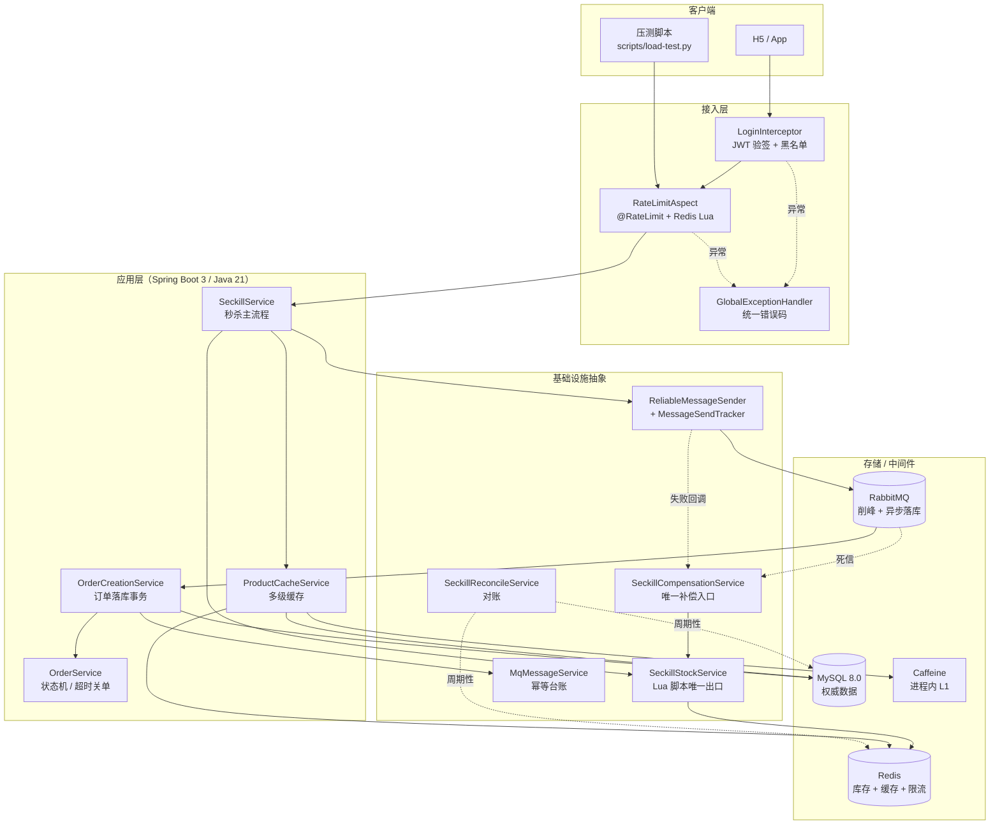
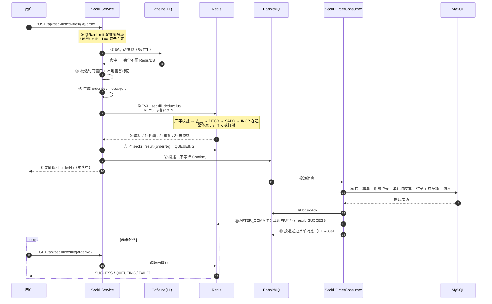
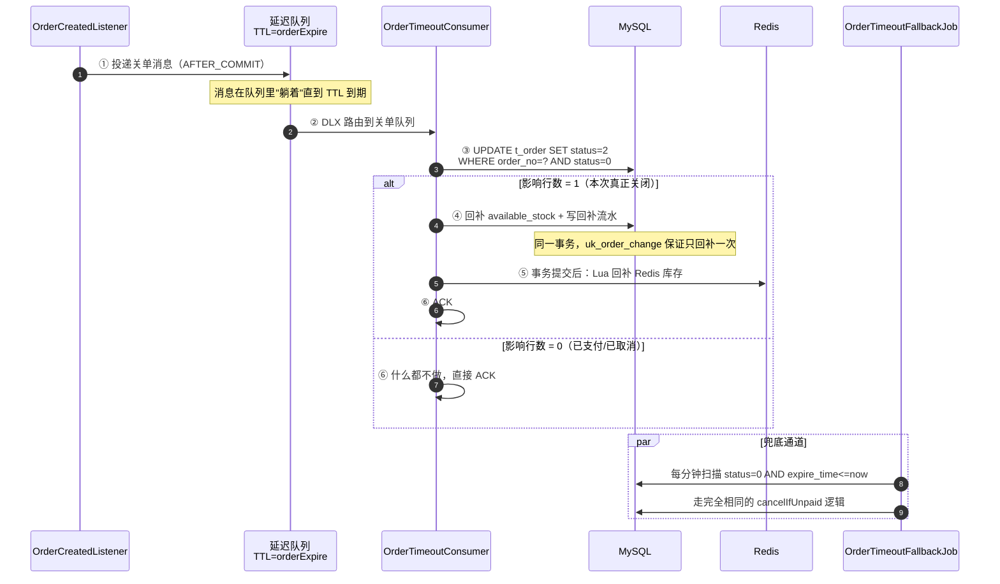
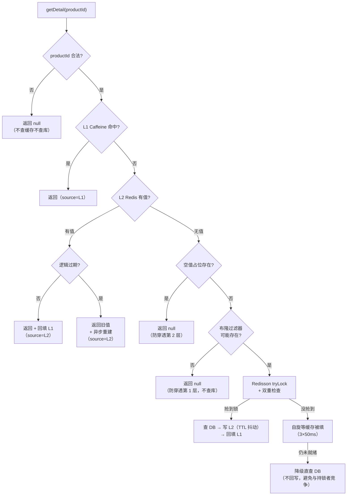
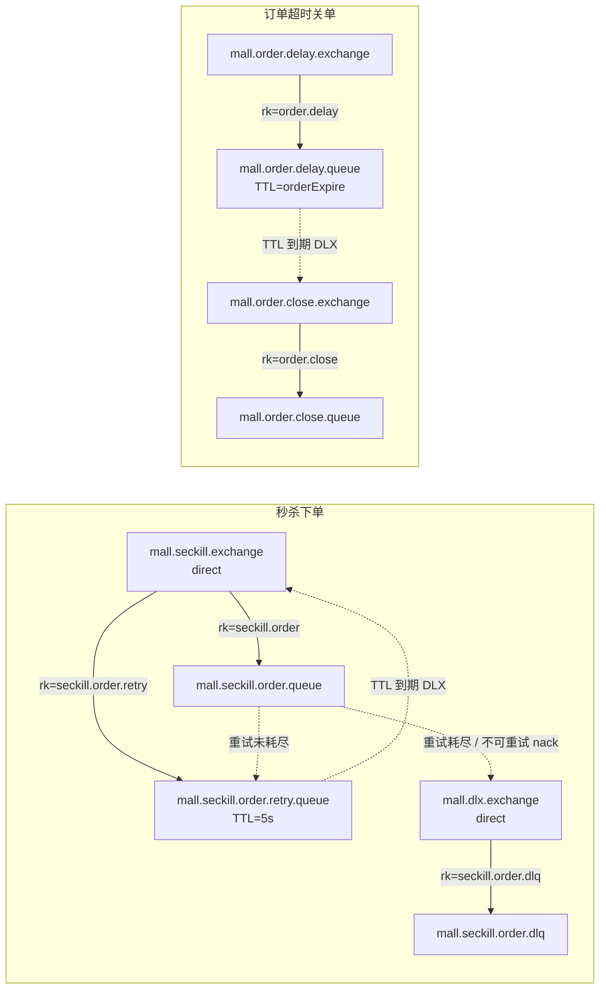

# 01 · 架构与核心链路

> 本文回答三个问题：**系统长什么样**、**一次抢购到底经过了哪些环节**、**每个环节挂了会怎样**。
>
> 配套阅读：[02-关键设计决策](./02-key-design.md)（为什么这么选）、[03-面试题库](./03-interview-qa.md)、[04-压测报告](./04-benchmark.md)、[05-踩坑记录](./05-pitfalls.md)。

---

## 1. 系统分层



**分层原则**：`基础设施抽象` 这一层不是简单的 DAO 包装，而是把**每个跨进程动作的失败语义**收敛到一个地方。
原因是分布式系统里真正难的不是"怎么成功"，而是"失败了怎么办"——补偿、幂等、对账这些逻辑一旦散落各处，必然会出现不一致。

---

## 2. 秒杀主链路（最重要的一张图）



**这条链路的三个关键性质**：

| 性质 | 实现手段 | 为什么重要 |
|---|---|---|
| **无同步数据库操作** | 扣减在 Redis、落库在 MQ 之后 | 接口 RT 与数据库负载完全解耦，数据库再慢也不会拖垮秒杀入口 |
| **扣减原子** | 单次 Lua EVAL | 不需要分布式锁，没有锁等待/锁超时/误删锁这些问题 |
| **返回与结果解耦** | 返回 orderNo，前端轮询 | 用户拿到"排队中"而不是"失败"，削峰才有意义 |

---

## 3. 订单超时关单链路



**为什么要有两条通道**：延迟消息负责"快"，扫描任务负责"对"。
消息系统只能保证"至少一次"，不能保证"一定送到"——broker 重启丢消息、队列被误删、投递时连接不可用，这些都会让延迟消息消失。
**任何靠消息触发的关键动作，都必须有一个按状态扫描的兜底任务。**

---

## 4. 缓存读取链路



**两套防击穿机制是互补的，不是二选一**：

- **逻辑过期**解决"热 key 到期"——缓存里有数据，只是旧了，可以先把旧数据返回给用户，同时异步刷新。
- **互斥锁**解决"冷 key 不存在"——缓存里根本没数据，所有并发请求会一起回源，必须用锁把它们收成一次查询。

---

## 5. Redis 数据结构与 Key 规范

| Key | 结构 | 用途 | TTL |
|---|---|---|---|
| `seckill:stock:{act:N}` | String | 剩余可抢库存，Lua DECR 的目标 | 覆盖活动周期 + 1h |
| `seckill:bought:{act:N}` | Set | 已购用户集合，一人一单准入判定 | ≥ 活动周期（`bought-set-ttl`） |
| `seckill:inflight:{act:N}` | String | 在途计数（已扣减未落库） | 24h |
| `seckill:activity:N` | String(JSON) | 活动 + 商品快照，热路径不碰 DB | 覆盖活动周期 + 1h |
| `seckill:result:{orderNo}` | String(JSON) | 抢购结果，供前端轮询 | 30min（排队中会续期） |
| `seckill:compensate:guard:{msgId}` | String | 补偿一次性守卫（SETNX） | 24h |
| `cache:product:N` | String(JSON) | 商品详情，`CacheValue{data,logicalExpireAt}` | 30min + 20% 抖动 |
| `cache:product:null:N` | String | 空值占位（防穿透） | 60s |
| `bloom:product` | Bitmap | 商品 ID 布隆过滤器 | 永久 |
| `auth:token:blacklist:{jti}` | String | 已退出令牌 | **= 令牌剩余有效期** |
| `rate:limit:{维度}:{目标}` | ZSET | 滑动窗口 | 窗口 + 1s |
| `rate:token:{维度}:{目标}` | HASH | 令牌桶 | 2×充能时间 |
| `lock:product:rebuild:N` | Redisson | 缓存重建互斥锁 | lease 10s |

### Hash Tag：集群可用性的关键

```
seckill:stock:{act:2001}       ┐
seckill:bought:{act:2001}      ├─ 同一个哈希槽
seckill:inflight:{act:2001}    ┘
```

Redis Cluster 用 `CRC16(key) % 16384` 分配槽位；key 含 `{...}` 时**只对大括号内的内容**计算哈希。
Lua 脚本涉及的所有 key 必须同槽，否则集群模式下直接报：

```
CROSSSLOT Keys in request don't hash to the same slot
```

> **这个错误在单机 Redis 上永远不会出现**。开发环境全绿、一上集群全崩，是典型的"测试环境掩盖问题"。
>
> 本项目用 `RedisClusterSlot`（自实现 CRC16-XMODEM，已用标准校验值 `0x31C3` 与 `foo→12182` 交叉验证）在**单元测试**里断言三个 key 同槽，并在 `SeckillStockService` 构造时做**启动自检**。
> 把"集群可用"从口头承诺变成 CI 与启动期的硬约束。

---

## 6. MySQL 表与索引

### 三组唯一索引 —— 幂等设计的地基

| 唯一索引 | 拦截什么 | 命中后的处理 |
|---|---|---|
| `uk_order_no` | 同一订单号重复落库 | 抛 `DuplicateOrderException` → 补偿 + ACK |
| `uk_user_activity` | Redis 一人一单判定被绕过 | 同上，并**告警**（说明出现了一致性缺口） |
| `uk_message_id` | 同一条 MQ 消息重复投递 | 抛 `DuplicateMessageException` → 直接 ACK |
| `uk_order_change`（t_stock_flow） | 同一订单重复回补/重复扣减 | 第二次插入失败 → 库存不会被多加 |

**关键设计：`uk_order_change(order_no, change_type)`**
超时关单回补与死信回补可能并发发生。把"同一订单的同一类库存变更只能落一次"做成数据库约束，
比在应用层加分布式锁便宜得多，也更可靠——**数据库约束是唯一无法被代码 bug 绕过的一层**。

### 主键策略

| 表 | 主键 | 理由 |
|---|---|---|
| `t_user` / `t_product` / `t_seckill_activity` | 自增 | 写少读多，自增的 B+ 树写入局部性最好 |
| `t_order` / `t_order_item` / `t_mq_message` / `t_stock_flow` | **雪花 ID** | 高并发插入下自增存在 AUTO-INC 锁竞争；且自增在分库分表时无法全局唯一 |

### 其他约束

- 金额一律 `DECIMAL(10,2)`，绝不用 `FLOAT/DOUBLE`。
- `CHECK (available_stock >= 0)` —— 应用层校验被绕过时，数据库这层仍能拦住超卖。
- `idx_status_expire (status, expire_time)` —— 专为兜底扫描 `status=0 AND expire_time<=now` 建的索引。

---

## 7. RabbitMQ 拓扑



**三个容易踩的点**：

1. **`mandatory=true` + ReturnCallback 缺一不可**。Confirm 只说"broker 收到了"，**不保证路由到了队列**。routingKey 写错时 broker 会 ack 然后丢弃消息，生产者以为成功、消息却消失了。
2. **`basic.return` 先于 `basic.ack` 到达**。补偿逻辑必须能处理这个顺序，并且必须幂等。
3. **消息级 TTL 会造成队头阻塞**。队列只检查队头是否过期，一条 TTL=30min 的消息堵在队头，后面 TTL=5s 的也得等。本项目同一队列内 TTL 统一，所以用队列级 TTL；若要支持不同超时，必须换成延迟插件或按档位拆队列。

---

## 8. 故障场景 → 兜底机制矩阵

这是整个设计最值得看的一张表：**每个组件挂掉之后，系统会怎么表现、由谁来收拾**。

| 故障 | 直接影响 | 兜底机制 | 用户可见行为 | 是否有资损风险 |
|---|---|---|---|---|
| **Redis 挂** | 秒杀扣减不可用 | 限流 fail-open 放行；秒杀接口快速失败（**绝不降级直查 DB**） | 抢购失败，提示稍后重试 | 无（不会超卖，只是少卖） |
| **Redis 主从切换丢数据** | 已购集合/库存丢失 | DB 的 `uk_user_activity` 兜住一人一单；对账任务重建库存 | 少数人可能抢到第二单但被 DB 拒绝 | 无 |
| **MQ 发送失败** | 库存扣了但订单不会创建 | 发送异常立即补偿；Confirm nack / Return 回调补偿；超时扫描补偿 | 前端轮询到 FAILED | 无（三重幂等防重复回补） |
| **broker 静默失联** | Confirm 永不返回 | `PendingMessageRetryJob` 每 2s 扫描超时条目 | 5 秒内轮询到 FAILED | 无 |
| **消费失败（瞬时）** | 订单未创建 | 投递到延迟重试队列，间隔 5s，最多 3 次 | 结果延迟几十秒 | 无 |
| **消费失败（重试耗尽）** | 订单未创建 | nack(requeue=false) → 死信队列 → 死信消费者检查订单状态后回补 | 轮询到 FAILED | 无 |
| **消费者进程崩溃** | 消息 unacked 自动重投 | RabbitMQ 自动重投；幂等由 `uk_message_id` 保证 | 结果延迟 | 无 |
| **生产者进程崩溃** | 内存台账丢失 | **对账任务**通过"在途计数泄漏探测"修复库存 | 该用户抢购失败 | 无 |
| **MySQL 挂** | 无法落库 | 消费失败 → 重试 → 死信；秒杀入口不受影响（不碰 DB） | 排队时间变长，最终失败 | 无 |
| **缓存与 DB 不一致** | 读到旧数据 | AFTER_COMMIT 删除 + 延迟双删（500ms）+ 短 L1 TTL（3s） | 最多 3 秒脏数据 | 无 |
| **超时关单消息丢失** | 订单永久待支付、库存被占 | `OrderTimeoutFallbackJob` 每分钟扫描 `expire_time` | 最多延迟 1 分钟关单 | 无 |
| **限流组件（Redis）故障** | 限流失效 | fail-open 放行 + `mall.rate.limit.degraded` 指标告警 | 无感知 | 有（失去保护，靠下游容量硬扛） |

> **贯穿全表的同一条原则：数据库是权威，Redis 是可重建的投影。**
> 任何冲突都以数据库为准，Redis 侧对齐过去。反过来（把 Redis 当权威）会把已经发生的错误固化进权威数据源。

---

## 9. 可观测性

所有关键决策都需要一个指标来验证，否则"我觉得没问题"没有任何意义。

| 指标 | 类型 | 标签 | 回答什么问题 |
|---|---|---|---|
| `mall.seckill.result` | Counter | `reason` | 秒杀各分支的真实占比（受理/售罄/重复/未预热/MQ失败） |
| `mall.seckill.lua` | Timer | — | Redis Lua 的 P50/P95/P99，判断 Redis 是否是瓶颈 |
| `mall.cache.access` | Counter | `cache,level,result` | **L1/L2/DB 各层命中率**，证明缓存真的挡住了数据库 |
| `mall.cache.rebuild` | Timer | `cache` | 异步重建耗时 |
| `mall.mq.event` | Counter | `topic,action` | 发送/确认/退回/消费/重试/死信全链路事件 |
| `mall.rate.limit.rejected` | Counter | `api,dimension` | 限流是保护还是误伤 |
| `mall.rate.limit.degraded` | Counter | `api` | **限流组件故障降级次数，> 0 必须告警** |
| `mall.reconcile.drift` | Counter + Gauge | `activity` | 库存漂移的绝对值 |

暴露在 `/actuator/prometheus`，另有 `/api/admin/**` 提供人类可读的即时快照：

```bash
curl -H "Authorization: Bearer $TOKEN" localhost:8080/api/admin/cache/product/stats
curl -H "Authorization: Bearer $TOKEN" localhost:8080/api/admin/seckill/2001/redis-state
curl -H "Authorization: Bearer $TOKEN" localhost:8080/api/admin/seckill/reconcile
curl -H "Authorization: Bearer $TOKEN" localhost:8080/api/admin/mq/pending
```

---

## 10. 目录结构

```
high-concurrency-mall/
├── pom.xml
├── Dockerfile                         多阶段构建
├── docker-compose.yml                 MySQL 3307 / Redis 6380 / RabbitMQ 5672+15672 / app(profile=full)
├── docs/                              设计文档与面试题库
├── scripts/load-test.py               压测脚本
└── src/main/
    ├── java/com/lxt/mall/
    │   ├── auth/                      JWT 签发解析、黑名单、登录拦截器
    │   ├── ratelimit/                 @RateLimit 注解 + 切面 + Lua 限流器
    │   ├── cache/                     多级缓存、逻辑过期、布隆过滤器、AFTER_COMMIT 失效
    │   ├── seckill/                   秒杀核心：主流程 / 库存 Lua 封装 / 预热 / 补偿 / 对账
    │   │   └── consumer/              秒杀消费者、死信消费者
    │   ├── order/                     订单落库事务、状态机、超时关单、事件监听
    │   ├── mq/                        可靠发送、投递跟踪、幂等台账、异常语义
    │   ├── job/                       对账 / 预热 / 超时兜底 / 投递补偿
    │   ├── product/                   商品服务与缓存读写
    │   ├── admin/                     运维可观测接口
    │   ├── metrics/                   Micrometer 业务埋点
    │   ├── common/                    统一响应、异常、上下文、Redis Key 规范
    │   ├── config/                    各类配置与 MallProperties
    │   └── domain/                    实体 / 枚举 / Mapper
    └── resources/
        ├── application*.yml            local / docker / benchmark / test
        ├── db/01-schema.sql            建表（幂等）
        ├── db/02-data.sql              演示数据
        └── lua/                        5 个 Lua 脚本（含大量注释说明为什么这么写）
```
