# 07 · 各业务板块流程详解

> 本文从“一个请求进入系统后发生了什么”的角度讲解项目，而不是按类名罗列代码。
> 建议先读总览，再重点阅读第 4～8 节的秒杀、消息、订单和补偿链路。

---

## 1. 系统总览

这个项目是一个以“商品浏览 + 限时秒杀”为核心的模块化单体应用。
主要参与者如下：

| 组件 | 职责 |
|---|---|
| Spring Boot 应用 | 接口、业务编排、事务、定时任务 |
| MySQL | 用户、商品、活动、订单、消息记录、库存流水的权威数据源 |
| Redis | JWT 黑名单、分布式限流、商品二级缓存、秒杀库存和抢购结果 |
| Caffeine | JVM 内商品缓存、活动快照、售罄标记、待确认消息上下文 |
| RabbitMQ | 秒杀请求削峰、消费重试、死信、订单延迟关单 |

完整业务关系：

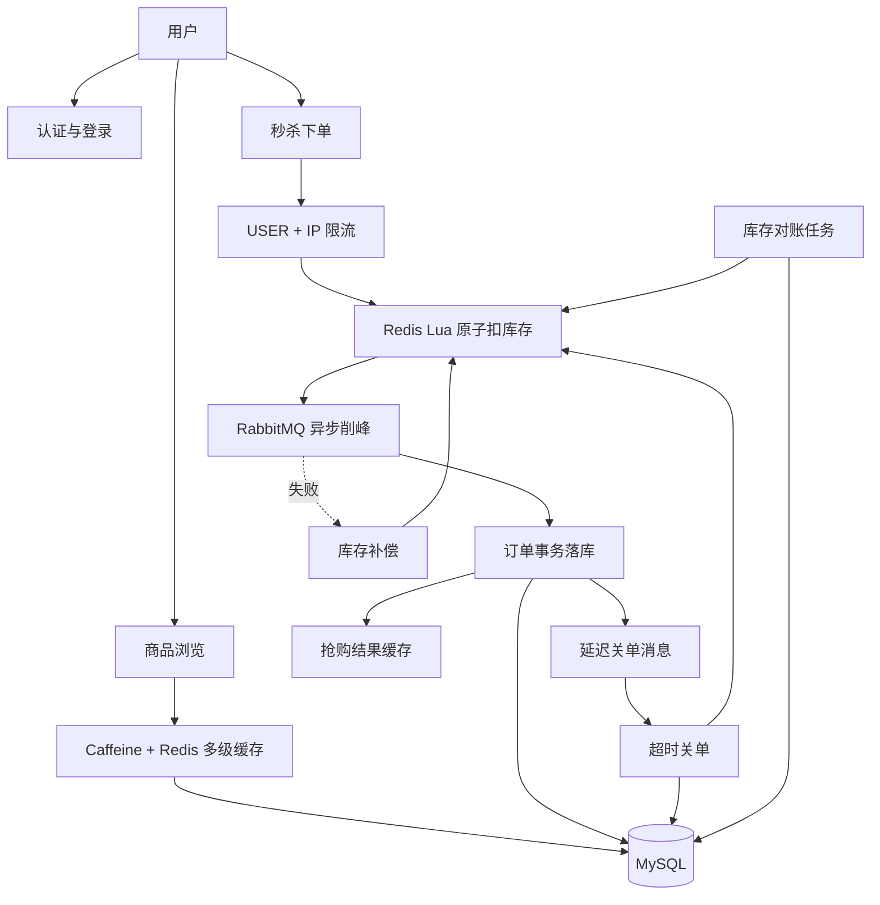

一次请求通常还会经过三层通用处理：

```text
HTTP 请求
  → LoginInterceptor：校验 JWT、黑名单并建立 UserContext
  → RateLimitAspect：执行接口声明的 Redis 限流规则
  → Controller → Service → Mapper / Redis / RabbitMQ
  → GlobalExceptionHandler：转换为统一 Result 响应
```

---

## 2. 用户认证板块

### 2.1 注册

接口：`POST /api/auth/register`

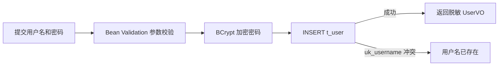

具体流程：

1. Controller 校验用户名、密码等请求参数。
2. `AuthService` 使用 BCrypt 对密码加盐哈希。
3. 用户直接写入 `t_user`。
4. 系统不采用“先查用户名、再插入”的方式判断重复，因为并发注册时两个请求可能同时查到不存在。
5. 最终由数据库 `uk_username` 唯一索引保证并发正确性。
6. 返回值不包含密码字段。

### 2.2 登录

接口：`POST /api/auth/login`

```text
按 IP 执行令牌桶限流
  → 按 username 查询用户
  → BCrypt.matches 校验密码
  → 检查用户状态
  → 生成带 userId、username、jti、过期时间的 JWT
  → 返回 token 和用户基本信息
```

用户名不存在和密码错误故意返回相同错误，避免攻击者利用返回差异枚举有效用户名。

### 2.3 已登录请求鉴权

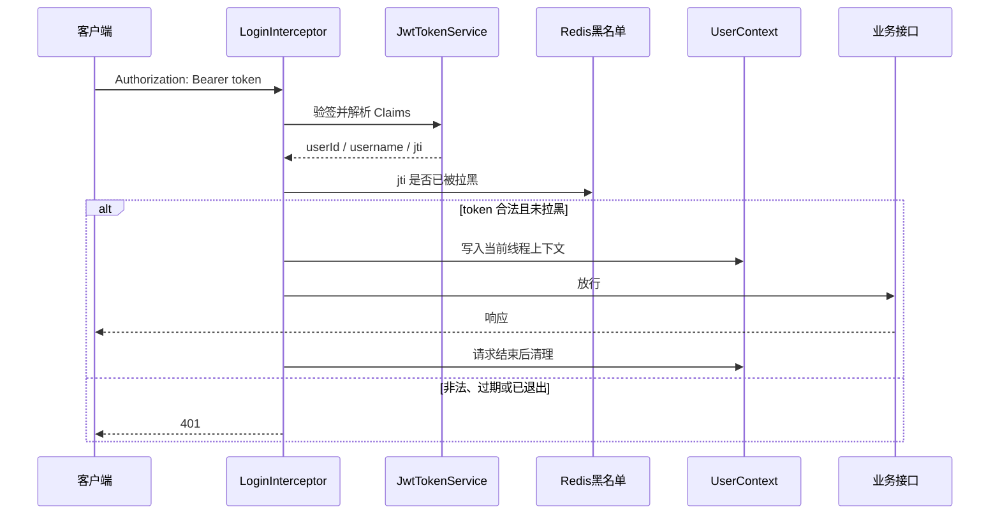

### 2.4 退出登录

接口：`POST /api/auth/logout`

JWT 本身是无状态的，服务端无法直接撤回。因此项目将 token 的 `jti` 写入 Redis 黑名单：

1. 解析当前 JWT。
2. 计算 token 剩余有效时间。
3. 写入 `auth:token:blacklist:{jti}`。
4. Redis TTL 等于 token 剩余有效时间。
5. 后续请求即使签名正确，也会因为命中黑名单被拒绝。

如果退出时 token 已过期或已经非法，接口仍视为退出成功。

---

## 3. 商品与多级缓存板块

商品读写采用 Cache Aside：读请求优先走缓存，写请求先修改数据库，再让缓存失效。

### 3.1 商品列表

接口：`GET /api/product/list`

商品列表目前直接分页查询 MySQL，只返回 `status=1` 的商品，不走商品详情缓存。

### 3.2 商品详情读取

接口：`GET /api/product/detail/{id}`

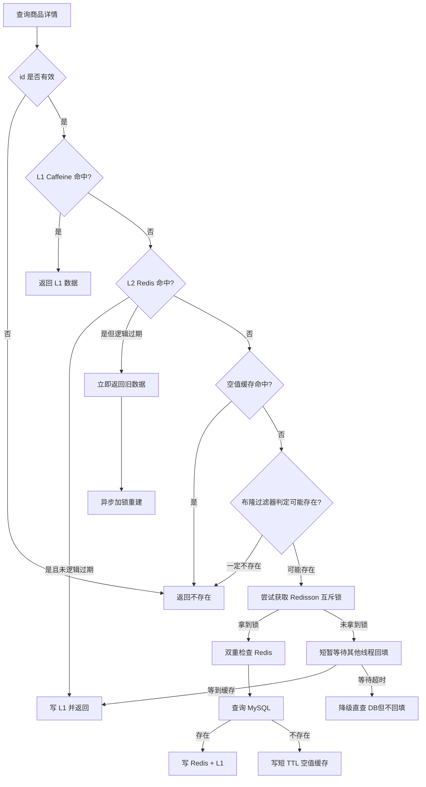

各层作用：

| 问题 | 解决方式 |
|---|---|
| 热点读压力 | L1 Caffeine 把大部分请求挡在进程内 |
| Redis 数据过期时的击穿 | 逻辑过期：先返回旧值，再异步重建 |
| 冷 Key 首次访问击穿 | Redisson 互斥锁 + 双重检查 |
| 查询不存在商品造成穿透 | 参数检查 + 布隆过滤器 + 空值缓存 |
| 大量 Key 同时到期 | Redis 物理 TTL 加随机抖动 |

### 3.3 新增商品

```text
开启数据库事务
  → INSERT t_product
  → 将新商品 ID 加入布隆过滤器
  → 发布 ProductChangedEvent
  → 事务提交
  → AFTER_COMMIT 删除该商品的 L1、L2、空值缓存
  → 500ms 后再次删除
```

新增时仍然要删空值缓存，因为用户可能在商品创建前查询过这个 ID，Redis 中已经存在“商品不存在”占位。

### 3.4 修改商品与缓存一致性

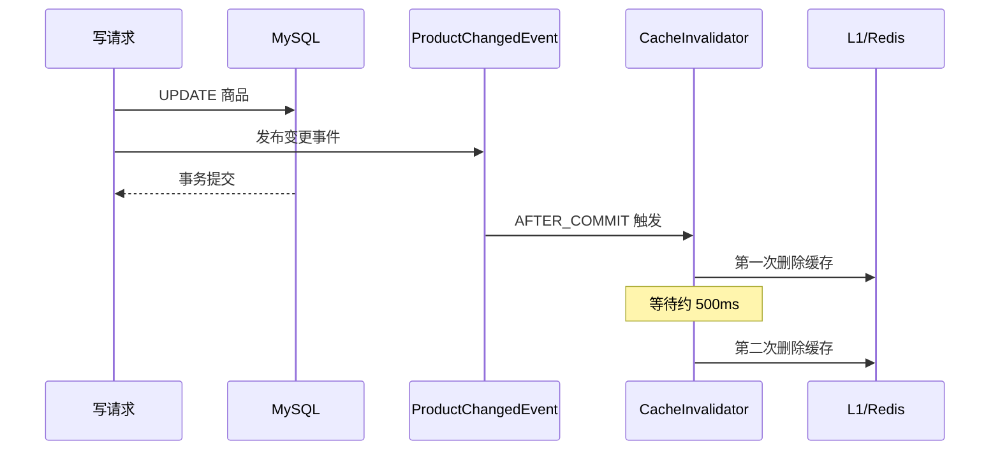

必须在事务提交后删除缓存，否则并发读可能从未提交的数据库版本读到旧值并重新写回缓存。
延迟双删用于清理第一次删除附近被并发请求回填的旧数据。

---

## 4. 分布式限流板块

限流不是独立业务接口，而是通过 `@RateLimit` 切面包围业务 Controller。

当前主要规则：

| 接口 | 算法 | 维度 |
|---|---|---|
| 登录 | 令牌桶 | IP |
| 商品详情 | 滑动窗口 | IP + API |
| 秒杀下单 | 滑动窗口 | USER + IP |

处理流程：

```text
进入带 @RateLimit 的方法
  → 从 application.yml 读取规则
  → 根据 USER / IP / API 生成限流 Key
  → 执行 Redis Lua
  → 所有维度均放行：执行业务方法
  → 任一维度拒绝：抛 RateLimitException
```

滑动窗口通过 Redis ZSet 记录窗口内请求时间；令牌桶根据上次补充时间和补充速率计算当前令牌数。Lua 保证“清理、统计、判断、写入”是原子的。

限流器默认采用 `fail-open`：Redis 限流组件异常时记录降级指标并放行业务，避免“限流系统故障导致全站不可用”。这提高了可用性，但生产环境仍需要网关、线程池和连接池提供额外容量保护。

---

## 5. 秒杀活动与预热板块

### 5.1 活动查询

- 活动列表从 MySQL 查询。
- 活动详情返回数据库活动信息及服务器时间。
- 秒杀热路径使用短 TTL 的 JVM 活动快照，避免每个抢购请求都访问 Redis 或 MySQL。

### 5.2 活动预热

来源包括启动预热、定时预热和手动预热接口。

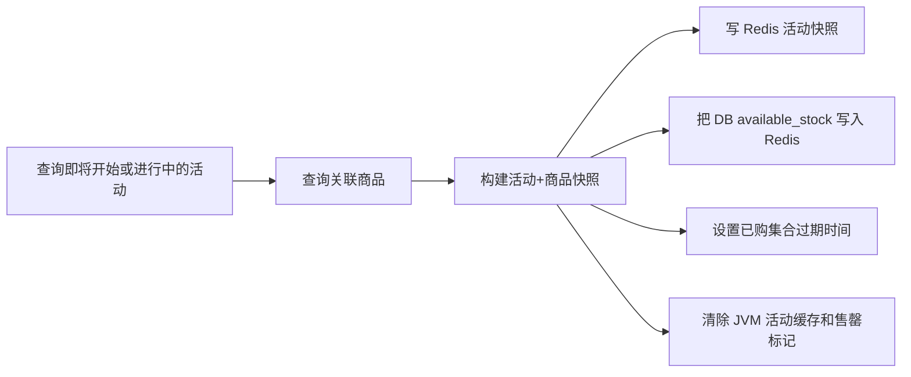

Redis 中主要数据：

```text
seckill:stock:{act:N}      剩余库存
seckill:bought:{act:N}     已获得购买资格的用户集合
seckill:inflight:{act:N}   Redis 已扣但订单尚未落库的数量
seckill:activity:N         活动与商品快照
```

重新预热使用数据库的 `available_stock`，不能使用 `total_stock`，否则已经售出的库存会被重新放出来。

注意：当前实现是在已购 Set 可能尚不存在时调用 `EXPIRE`。Redis 对不存在的 Key 设置过期时间不会生效，而后续 Lua `SADD` 创建 Set 时也不会自动带 TTL。这是当前预热流程需要修正的一个实现细节。

---

## 6. 秒杀下单主流程

接口：`POST /api/seckill/activities/{activityId}/order`

这是整个项目最热的同步链路，目标是尽量不接触数据库。

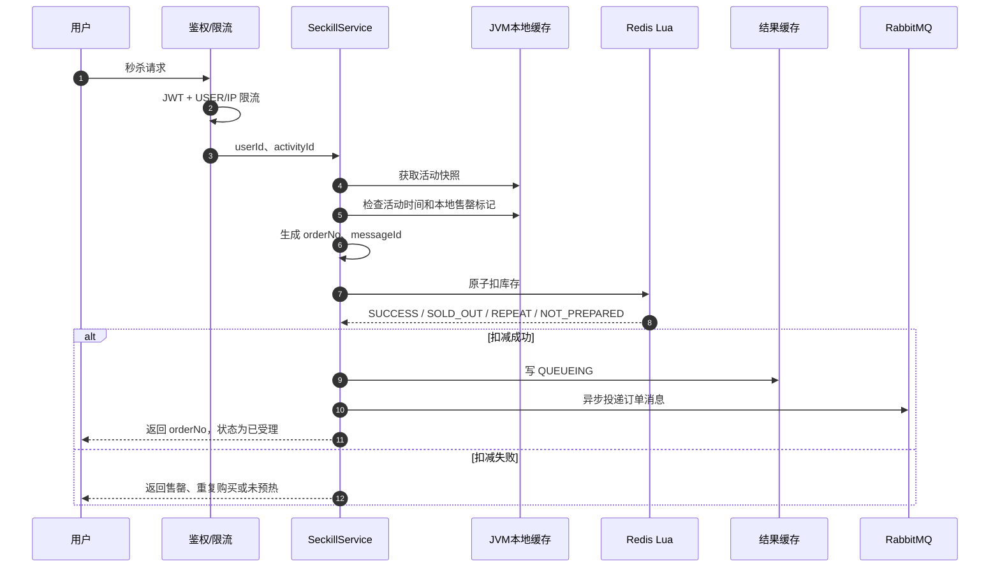

### 6.1 Redis Lua 原子扣减

Lua 在一次执行内完成：

1. 检查库存 Key 是否存在，判断活动是否预热。
2. 检查用户是否已经在已购集合。
3. 判断库存是否大于 0。
4. `DECR` 扣减库存。
5. `SADD` 记录用户购买资格。
6. `INCR` 增加在途计数。

返回码：

| 返回值 | 含义 | 后续处理 |
|---|---|---|
| `0` | 成功 | 写排队结果并发 MQ |
| `1` | 售罄 | 设置 JVM 本地售罄标记并拒绝 |
| `2` | 重复购买 | 直接拒绝 |
| `3` | 未预热 | 拒绝，不降级查数据库 |

三个秒杀 Key 都包含相同的 `{act:N}` Hash Tag，确保在 Redis Cluster 中落到同一个槽，Lua 才能跨 Key 原子执行。

### 6.2 为什么先写 QUEUEING 再发消息

如果顺序反过来，消费者可能极快地创建订单并写入 `SUCCESS`，随后生产者再写 `QUEUEING`，最终把成功状态覆盖成排队中。因此顺序必须是：

```text
Redis 扣库存成功 → 写 QUEUEING → 发 MQ → 返回 orderNo
```

### 6.3 查询抢购结果

接口：`GET /api/seckill/result/{orderNo}`

当前 Controller 的真实顺序是：

```text
先按 orderNo 查询 MySQL 订单并校验所属用户
  → 找到订单：返回 OrderVO
  → 没有找到：读取 Redis 抢购结果
  → Redis 为 QUEUEING 或缓存缺失：提示继续轮询
```

因此数据库是最终结果来源，Redis 结果缓存主要用来表达“仍在排队”或“异步处理失败”。

---

## 7. RabbitMQ 可靠消息板块

### 7.1 生产者投递

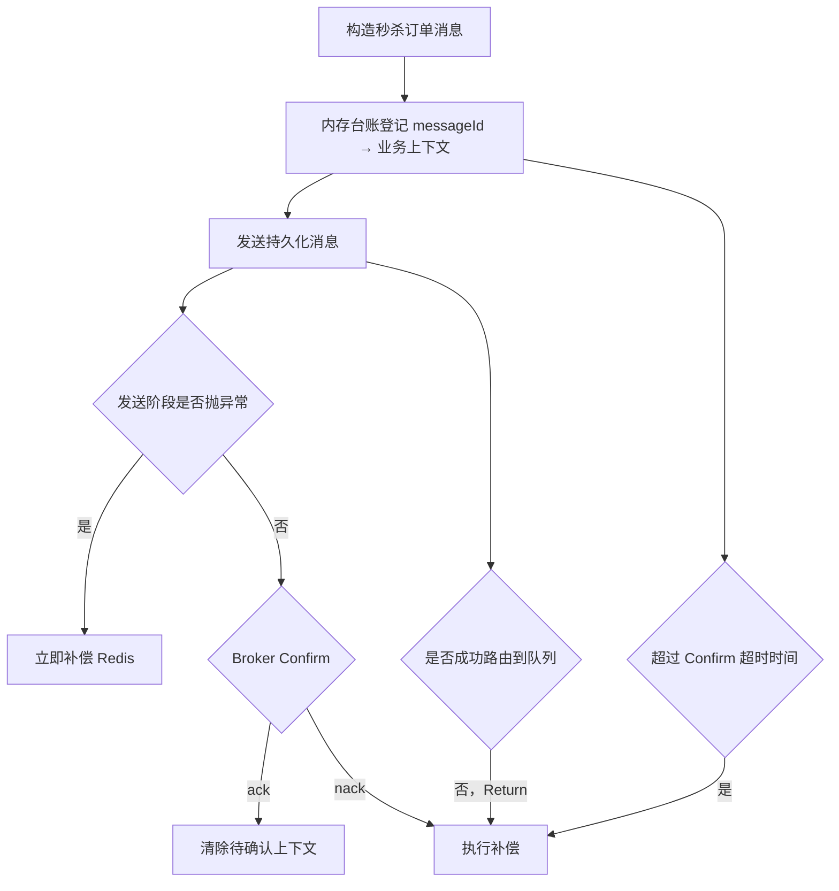

Confirm 只能证明 Broker 接收了消息，不能证明消息进入了某个队列。因此还要开启 `mandatory=true` 并处理 Return 回调。

同一消息可能同时触发 Return、Confirm nack、发送异常或超时扫描，真正的补偿防重由统一补偿服务完成。

### 7.2 消费者处理结果

秒杀消费者使用手动 ACK，根据异常语义选择不同动作：

| 结果 | 行为 |
|---|---|
| 订单创建成功 | ACK |
| 消息已消费过 | ACK，不重复处理 |
| 用户订单唯一键冲突 | 补偿本次 Redis 预扣后 ACK |
| 活动不存在、DB 库存不足等永久错误 | 补偿后 `nack(requeue=false)` 进入死信 |
| 数据库连接抖动等临时错误 | 投递到 5 秒延迟重试队列，再 ACK 原消息 |
| 达到最大重试次数 | `nack(requeue=false)` 进入死信 |
| 重试消息也无法投递 | `nack(requeue=true)`，让 Broker 保留原消息 |

重试过程中保持原 `messageId` 不变，保证数据库幂等约束仍然有效。

### 7.3 死信处理

```text
死信消费者收到消息
  → 查询数据库中是否已经存在该订单
  → 已存在：说明业务可能成功但 ACK 失败，不补偿
  → 不存在：执行库存与购买资格补偿
  → 处理成功后 ACK
  → 无法查询数据库：requeue，等待数据库恢复
```

“进入死信”不等于“业务失败”。必须以数据库是否存在订单为准，否则可能把已经成功订单的库存又放回去，造成超卖。

---

## 8. 订单落库与幂等板块

### 8.1 秒杀订单创建事务

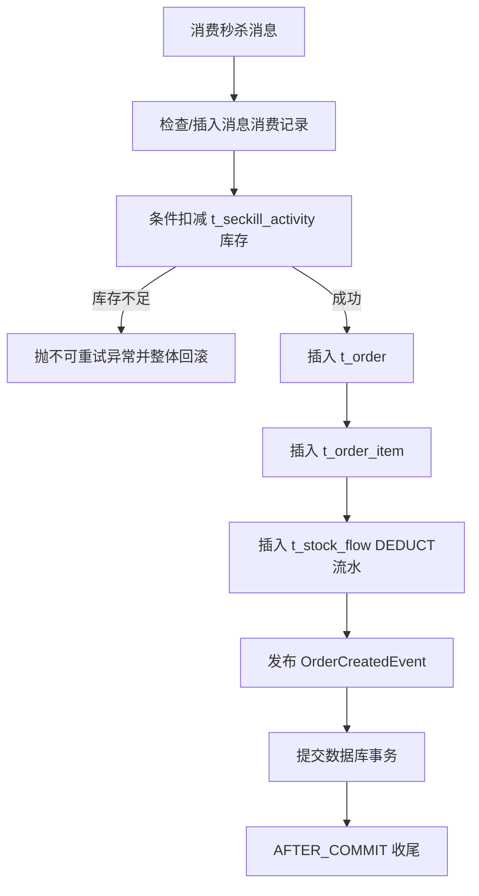

这五项必须在同一个数据库事务中：

1. 消息消费记录。
2. 数据库库存扣减。
3. 订单。
4. 订单项。
5. 库存流水。

任意一步失败，所有数据库修改一起回滚。

数据库幂等防线：

| 唯一约束 | 防止的问题 |
|---|---|
| `t_mq_message.uk_message_id` | 同一消息重复消费 |
| `t_order.uk_message_id` | 同一消息重复创建订单 |
| `t_order.uk_order_no` | 订单号碰撞 |
| `t_order.uk_user_activity` | 同一用户重复购买同一活动 |
| `t_stock_flow.uk_order_change` | 同一订单重复扣减或重复回补 |

数据库扣库存使用类似下面的条件更新：

```sql
UPDATE t_seckill_activity
SET available_stock = available_stock - 1
WHERE id = ? AND available_stock >= 1;
```

Redis 负责挡流量，数据库条件更新和约束才是最终不超卖防线。

### 8.2 事务提交后的收尾

订单事务成功提交后，`OrderCreatedListener` 执行三个动作：

1. Redis 在途计数减一。
2. 抢购结果缓存写成 `SUCCESS`。
3. 投递订单超时关单消息。

这些动作不能放在数据库事务提交前，否则数据库最终回滚时，Redis 或 MQ 已经产生不可回滚的副作用。

### 8.3 支付

接口：`POST /api/order/{orderNo}/pay`

```text
查询订单
  → 条件更新 CREATED → PAID
  → 更新成功：记录 pay_time
  → 更新失败：订单可能已支付或已取消，返回状态冲突
```

条件更新保证支付回调重复到达时只有一次真正完成状态迁移。

### 8.4 主动取消

接口：`POST /api/order/{orderNo}/cancel`

```text
校验订单归属
  → 数据库事务：CREATED → CANCELED
  → 回补 DB available_stock
  → 写 ROLLBACK 库存流水
  → 数据库事务提交
  → 再通过 Lua 回补 Redis 库存
```

数据库先提交、Redis 后回补。这样 Redis 回补失败最多导致暂时少卖，后续可以对账修复；如果先回补 Redis 后数据库事务回滚，则可能放出不存在的库存并导致超卖。

取消订单后只放回库存，不回收该用户的秒杀资格，因为数据库仍保留该用户的订单，`uk_user_activity` 不允许他再次下单。

---

## 9. 订单超时关单板块

### 9.1 延迟消息路径

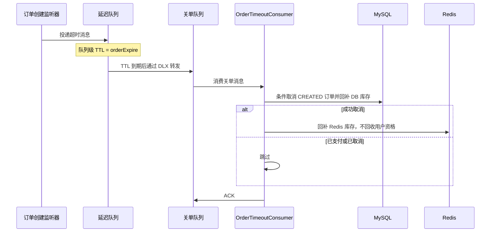

### 9.2 扫描兜底

如果延迟消息没有发送成功或消费失败，`OrderTimeoutFallbackJob` 会定期查询：

```text
status = CREATED AND expire_time <= 当前时间
```

然后走同一套取消与库存回补流程。因此延迟消息是及时关单的主通道，数据库扫描是可靠性兜底。

---

## 10. 库存补偿板块

补偿针对的是“Redis 已经扣库存，但订单最终没有落库”。可能来源包括：

- RabbitMQ 发送直接失败。
- Broker Confirm nack。
- 消息无法路由而被 Return。
- Confirm 长时间没有返回。
- 消费永久失败或重试耗尽。
- 死信消费者确认订单不存在。

统一补偿流程：

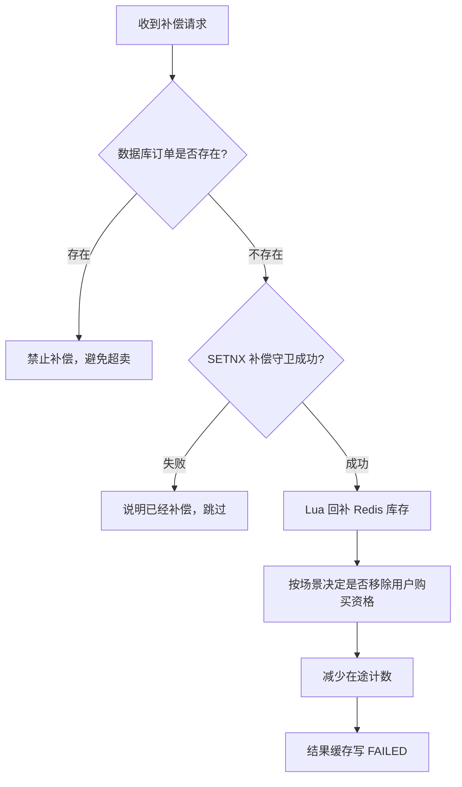

三层防重：

1. 先查订单是否已经存在。
2. Redis `SETNX` 保证同一 `messageId` 只补偿一次。
3. Lua 将回补后的库存封顶在活动总库存。

补偿失败时不无限阻塞消息，由库存对账任务做最后兜底。

---

## 11. 库存对账板块

系统维护下面的不变式：

```text
Redis 库存 = DB available_stock - inflight
```

原因是：Redis 已扣、数据库还没扣的请求会暂时记录在 `inflight` 中。

对账流程：

```text
查询尚未结束的活动
  → 读取 Redis stock 和 inflight
  → 读取 DB available_stock
  → expected = DB库存 - inflight
  → drift = Redis库存 - expected
  → drift = 0：一致
  → drift != 0：记录指标、告警，并按配置修复
```

此外还会检测在途泄漏：正常请求的 `inflight` 只存在几十毫秒；如果连续三轮、每隔约五分钟仍然大于零，大概率是应用在“Redis 扣减后、订单完成前”崩溃造成的残留。

修复方向始终是“以 MySQL 为准，重建 Redis”，因为数据库有事务、唯一索引和库存约束，Redis 只是可重建的高性能投影。

当前实现需要留意两个细节：

- 配置项 `drift-tolerance` 尚未参与实际判断。
- 修复方法先写 `targetStock`，随后调用预热又会用 DB `available_stock` 覆盖它；存在合法在途消息时可能过早释放预留库存。

---

## 12. 定时任务板块

| 任务 | 作用 | 兜底对象 |
|---|---|---|
| `SeckillPreheatJob` | 提前把活动快照与库存放入 Redis | 防止活动开始瞬间集中回源 |
| `PendingMessageRetryJob` | 扫描超过 Confirm 超时的待确认消息 | Broker 静默失联、回调丢失 |
| `OrderTimeoutFallbackJob` | 扫描过期未支付订单并关单 | 延迟消息发送或消费失败 |
| `SeckillReconcileJob` | 对比 Redis、DB 和在途库存 | 进程崩溃、补偿遗漏、人工误改 |

这四个任务体现了项目的一项核心思路：实时链路负责快速处理，定时任务负责让异常状态最终收敛。

---

## 13. 运维与可观测板块

### 13.1 管理接口

`/api/admin` 下提供：

- Caffeine 命中率统计。
- 清理本地或指定商品缓存。
- 查看活动 Redis 库存、在途数、已购人数、售罄标记。
- 执行库存对账。
- 查看未收到 Confirm 的消息数量。

### 13.2 指标

Micrometer 记录：

- 秒杀各结果数量。
- Redis Lua 执行耗时。
- L1、L2、DB 各层缓存命中情况。
- 缓存异步重建结果。
- MQ 发送、确认、退回、重试、死信事件。
- 限流拒绝与降级次数。
- 库存漂移。

指标通过 `/actuator/prometheus` 暴露。

生产环境需要特别处理权限：当前项目没有管理员角色模型，普通登录用户也能访问管理接口；同时 Actuator 公开了较多敏感端点，不能原样暴露到公网。

---

## 14. 数据表之间的关系

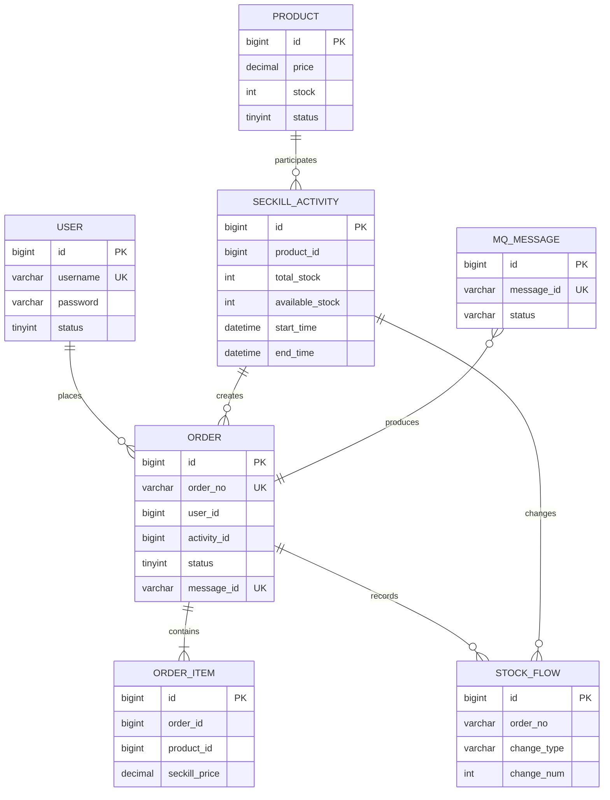

其中最重要的库存字段是 `t_seckill_activity.available_stock`。`t_product.stock` 是普通商品库存展示字段，当前秒杀订单真正扣减的是活动表库存。

---

## 15. 推荐阅读顺序

如果要通过源码理解项目，建议按以下顺序：

1. `SeckillController`：了解对外接口。
2. `SeckillService`：理解同步秒杀入口。
3. `seckill_deduct.lua`：理解 Redis 原子扣减。
4. `ReliableMessageSender` 与 `MessageSendTracker`：理解生产者可靠性。
5. `SeckillOrderConsumer`：理解 ACK、重试和死信决策。
6. `OrderCreationService`：理解订单事务与数据库幂等。
7. `OrderCreatedListener`：理解事务提交后的收尾。
8. `OrderTimeoutConsumer`：理解超时关单。
9. `SeckillCompensationService`：理解失败回补。
10. `SeckillReconcileService`：理解最终一致性。
11. `ProductCacheService`：理解多级缓存完整链路。

## 18. 秒杀抽签与风控

### 18.1 预约抽签

```text
预约（活动开始前，uk_activity_user 去重）
   → 开奖（<活动开始前 1 分钟> 或管理员手动）
        洗牌 → 前 N 名中签并生成资格码 → 写 Redis 集合
   → 下单：必须带 qualifyCode，Lua 内 SREM 原子消费
```

削峰效果：进入扣减链路的请求量从"人群量级"降到"库存量级"。

### 18.2 设备风控

```text
下单前：SISMEMBER seckill:risk:dev:{act:N} deviceId   （只读）
  命中 → 写 t_seckill_risk_hit + 返回 20012
扣减成功后：SADD 同一集合（TTL 24h）
```

- 检查只读、标记在成功后：否则"没抢到还把你拉黑"；
- 按活动维度隔离：A 活动用过不影响 B 活动；
- 设备号可选：拿不到就放行，由 IP 限流兜底。

### 18.3 取消后为什么能重新买

订单表用 `active_flag`（1 有效 / NULL 失效）参与唯一索引：
取消或退款时置 NULL，于是"同一活动同时只能有一笔有效订单"成立，而用户可以再次购买，
历史订单仍然保留可查。同时 Redis 侧必须回补库存并**释放购买资格**（`releaseQualification=true`），
否则会出现"数据库允许、Redis 拒绝"的分裂。

---

## 19. 搜索与网关

### 19.1 商品搜索

```text
GET /api/product/search?keyword=
  → ES 可用：multi_match(title^2, subTitle) + operator=and + filter(status=1)
  → ES 异常：LIKE 查询（记 WARN，接口语义不变）
```

`operator=and` 是踩过坑的：默认 OR + 中文按字分词会让"不存在的商品"命中一堆结果。

索引维护：

- 启动时全量重建（`ApplicationReadyEvent`，避免 `@PostConstruct` 时表还没初始化）；
- 变更后增量同步（`AFTER_COMMIT`，先库后索引，避免搜到不存在的商品）。

### 19.2 网关

```text
客户端 → 网关(:8081) → 业务服务(:8080)
            ├─ 固定窗口限流（每 IP，Redis INCR+PEXPIRE，fail-open）
            ├─ X-Request-Id 注入（与 traceId 互补：一个全量、一个采样）
            └─ 路由在 Java 中声明（4.2 起配置前缀变过，YAML 写错是静默 404）
```

网关**不做 JWT 验签**：令牌签发、黑名单、权限都在业务侧，重复实现只会产生两套鉴权规则。

---

## 20. 定时任务汇总（V2）

| 任务 | 频率 | 兜底对象 |
|---|---|---|
| `SeckillPreheatJob` | 每分钟 | 活动开始瞬间的集中回源 |
| `PendingMessageRetryJob` | 每 2 秒 | Confirm 丢失 / broker 静默失联 |
| `OrderTimeoutFallbackJob` | 每分钟 | 延迟关单消息丢失 |
| `SeckillReconcileJob` | 每分钟（默认） | 库存漂移、在途泄漏 |
| `ActivityStatusSyncJob` | 30 秒 | 活动状态与时间不一致 |
| `SeckillDrawJob` | 30 秒 | 抽签活动到点未开奖 |

> 共同原则：**实时链路负责快，定时任务负责不漏**。
> 任何"靠消息触发的关键动作"都必须有一个按状态扫描的兜底任务。

---

一句话总结整个项目：

> 秒杀链路用**本地缓存 + Redis Lua + MQ** 把高并发挡在数据库之外，用**唯一索引、幂等、补偿、死信与对账**保证最终正确；
> 交易链路用**同步事务 + 状态机**保证确定性；营销、抽签、风控、搜索、网关各自解决一类具体问题——
> 而每一条结论都对应一个可观测信号或一条可复现的测试。
