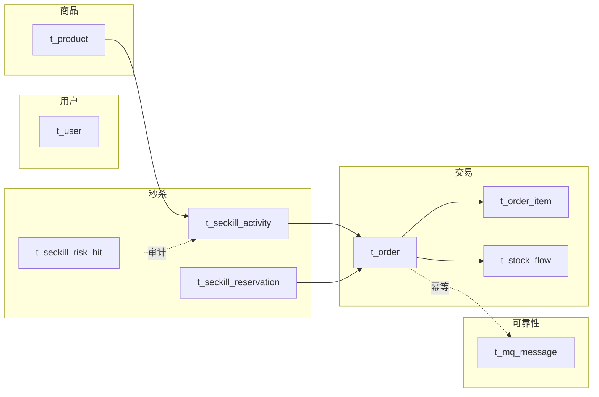

# 数据库全量讲解 —— 9 张表各自是干什么用的

> 本文是 [11-database-design.md](11-database-design.md) 的**全量版**。
> 11 号文档以"为什么要有这些表"入门；本文覆盖当前全部 **9 张表**，
> 每张表回答三个问题：**存什么、谁写谁读、哪个约束在防什么事故**。
>
> 建库脚本：`src/main/resources/db/01-schema.sql`（全部幂等 `CREATE TABLE IF NOT EXISTS`，可重复执行）。
>
> 更早的 17 表版本（含 SKU / 支付 / 退款 / 购物车 / 优惠券 / 拼团）保留在 git tag **`v2-full`**。

---

## 0. 全景：9 张表按职责分组



| 表 | 一句话 | 关键约束 |
|---|---|---|
| `t_user` | 账号 | `uk_username` |
| `t_product` | 商品（单 SKU 特例） | — |
| `t_seckill_activity` | 秒杀活动与库存 | `CHECK available_stock >= 0` |
| `t_seckill_reservation` | 预约/中签/资格码 | `uk_activity_user`、`uk_qualify_code` |
| `t_seckill_risk_hit` | 风控拦截审计 | — |
| `t_order` | 订单 | `uk_order_no`、`uk_user_activity`、`uk_message_id` |
| `t_order_item` | 订单明细 | — |
| `t_mq_message` | 消息投递/消费台账 | `uk_message_id` |
| `t_stock_flow` | 库存流水 | `uk_order_change` |

---

## 1. `t_user` — 账号

- **存什么**：用户名、BCrypt 密文、昵称、手机号、状态。
- **谁写**：注册、`DataSeeder`（演示账号）。
- **谁读**：登录、当前用户信息。
- **约束在防什么**：`uk_username` 防止两个人并发注册同一个用户名——
  先查再插在并发下必然穿透（两人都查到"不存在"），唯一键才是最后一道闸门。

---

## 2. `t_product` — 商品

- **存什么**：标题、副标题、封面、原价、展示库存、上下架状态、详情 JSON。
- **谁写**：商品管理接口；**谁读**：商品列表、详情（走多级缓存）。
- **注意**：`stock` 只是展示字段。**秒杀扣的是活动库存**（`t_seckill_activity.available_stock`），
  两者不联动——真实电商里应该由"库存中心"统一管理，这里刻意保持简单。

---

## 3. `t_seckill_activity` — 秒杀活动

- **存什么**：商品、秒杀价、总库存、剩余库存、起止时间、状态、模式（直接抢 / 抽签）。
- **谁写**：预热任务读它、消费端扣减 `available_stock`、关单/退款回补、状态同步任务维护 `status`。
- **谁读**：活动列表/详情、预热、对账。
- **约束在防什么**：
  - `CHECK (available_stock >= 0)`：**即使应用层校验被绕过，数据库也不允许扣成负数**；
  - `total_stock` 是快照，回补时用它封顶（`available_stock + n <= total_stock`），
    避免重复回补把库存"补多"。

> `status` 是时间的派生值，由 `ActivityStatusSyncJob` 每 30 秒对齐一次。
> 不做这件事的后果是：活动结束三个月后，列表里仍然显示"进行中"。

---

## 4. `t_seckill_reservation` — 预约与抽签

- **存什么**：谁在哪个活动预约、是否中签、资格码、抽签批次。
- **谁写**：预约接口（插入/幂等）、开奖任务（置中签 + 生成码）、下单后置"资格已使用"。
- **谁读**：用户查询自己的结果；开奖时统计参与人数。
- **约束在防什么**：
  - `uk_activity_user`：一个人对一个活动只能预约一次（也是"不会被抽中两次"的依据）；
  - `uk_qualify_code`：资格码全局唯一，且只发一次。

---

## 5. `t_seckill_risk_hit` — 风控拦截审计

- **存什么**：被拦截的活动、用户、设备指纹、IP、原因。
- **谁写**：`SeckillRiskGuard`（**只记录被拦截的请求**，正常请求不写）。
- **谁读**：`/api/admin/seckill/{id}/risk-hits` 按原因统计。
- **为什么需要它**：拦截率是唯一能回答"风控到底有没有用"的指标。
  只挡不记，既无法向运营证明价值，也无法在误杀时回溯。

---

## 6. `t_order` — 订单（最重要的一张）

- **存什么**：订单号、用户、活动、商品快照（标题/单价）、应付金额、状态、消息 ID、过期时间。
- **谁写**：消费端（同一事务插入）、支付回调（0→1）、关单（0→2）。
- **谁读**：订单详情/列表、支付、关单扫描、对账。
- **三个唯一键分别在防什么**：

| 唯一键 | 防的事故 |
|---|---|
| `uk_order_no` | 用户点两次 / 消息重投导致重复建单 |
| `uk_user_activity(user_id, activity_id, active_flag)` | Redis 的"一人一单"判定被绕过时的**最后防线** |
| `uk_message_id` | 同一条 MQ 消息被消费两次 |

- **`active_flag` 为什么存在**：值为 1 表示订单有效，`NULL` 表示已取消。
  唯一索引带上它之后，"一人一单"就变成**"同一活动同时只能有一笔有效订单"**——
  取消后能重新抢，历史订单还留着。MySQL 唯一索引允许多个 `NULL`，这个特性正好用上。
- **快照字段为什么存在**：商品改价改名后，历史订单必须保持下单时的样子。**订单是合同。**

---

## 7. `t_order_item` — 订单明细

- **存什么**：订单里每一项商品（当前是单商品，但保留一对多结构）。
- **谁写**：消费端同一事务；**谁读**：订单详情。
- **为什么单独一张表**：订单头是"交易"，明细是"商品项"，将来支持多商品/多 SKU 时不用改订单表。

---

## 8. `t_mq_message` — 消息台账（一张表三个职责）

| 职责 | 怎么用 |
|---|---|
| a) 生产投递记录 | `direction=1`：Confirm 超时未确认的消息由此重投 |
| b) 消费幂等 | `uk_message_id`：消费前插入，撞键即为重复消息 |
| c) 失败台账 | `status=2`：死信 / 人工排查 / 对账的依据 |

- **为什么与订单在同一个事务里写消费记录**：如果先写消费记录、再单独开事务写订单，
  订单事务回滚后消费记录还在，消息重投时会被误判为"已消费"直接 ACK——
  **消息被永久丢弃且没有任何报错**，这是可靠消息里最隐蔽的一类 bug。

---

## 9. `t_stock_flow` — 库存流水

- **存什么**：每次库存变更的类型（扣减/回补）、数量、变更前后值、备注。
- **谁写**：下单扣减、取消/退款回补、对账修复。
- **约束在防什么**：`uk_order_change(order_no, change_type)` ——
  同一订单的"扣减"和"回补"各只能落一次。超时关单与死信回补同时触发时，
  只有一个能写进去，**这是"库存不会被回补两次"的最后一道闸门**。
- **谁读**：排查"这单库存到底动了几次"、对账辅助。

---

## 10. 表之间的关系（一句话版）

```text
用户 --1:N--> 订单 <--N:1-- 活动 <--1:N-- 商品
订单 --1:N--> 明细
订单 --1:N--> 库存流水（扣减/回补各一次）
活动 --1:N--> 预约记录（中签者才有资格码）
订单 --1:1--> 消息（消费幂等键）
```

> **没有外键**：这是刻意的。高并发写入下外键会带来额外的锁与校验开销，
> 而"引用完整性"在这个项目里由**应用层事务 + 唯一索引 + 对账**共同保证。
> 需要强调：这是一个可辩护的取舍，不是疏忽。
