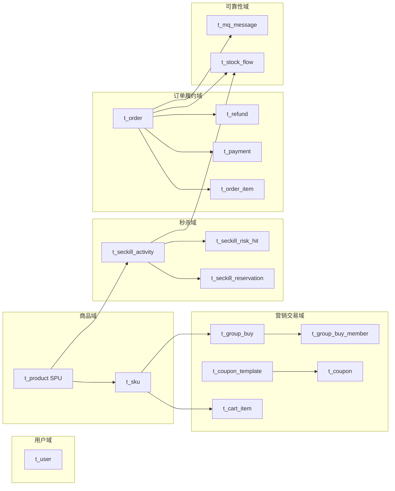

# 数据库全量讲解 —— 17 张表各自是干什么用的

> 本文是 [11-database-design.md](11-database-design.md) 的**全量补全版**。
> 11 号文档以最初的 7 张核心表入门讲透了"为什么要有这些表"；本文覆盖项目演进到今天的**全部 17 张表**，
> 每张表都回答三个问题：**存什么、谁写谁读、哪个约束在防什么事故**。
>
> 建库脚本：`src/main/resources/db/01-schema.sql`（全部幂等 `CREATE TABLE IF NOT EXISTS`，可重复执行）。
> 演进脚本：`db/migrations/V2__…V8__…`，记录了从 7 表到 17 表的每一步加表。

---

## 0. 全景：17 张表按业务域分组



一句话分工：

| 域 | 表数 | 存在的意义 |
|---|---|---|
| 用户域 | 1 | 谁在买 |
| 商品域 | 2 | 卖什么、多少钱、有多少货 |
| 秒杀域 | 3 | 限时限量抢购的活动、抽签资格、风控拦截证据 |
| 营销交易域 | 5 | 购物车、优惠券、拼团——普通下单的配套玩法 |
| 订单履约域 | 4 | 交易的核心账本：订单、明细、支付、退款 |
| 可靠性域 | 2 | 消息不丢不重、库存变动可追溯 |

---

## 1. 贯穿全库的 6 条设计纪律

在读任何一张表之前，先记住这 6 条——它们解释了几乎所有字段类型和约束为什么长这样：

| # | 纪律 | 体现 |
|---|---|---|
| 1 | **金额一律 `DECIMAL(10,2)`**，绝不用 FLOAT/DOUBLE | 所有 `price / amount / pay_amount / discount` 字段 |
| 2 | **时间统一 `DATETIME(3)` 毫秒精度** | 超时关单、状态竞争、拼团到期都靠毫秒时间戳判定 |
| 3 | **高并发写入表用雪花 ID**，低并发表自增 | 订单/流水/消息/券/团/明细用雪花；用户/商品/活动模板自增 |
| 4 | **唯一索引 + `CHECK` 是最后一道防线** | Redis Lua 挡高频，DB 约束兜底，应用层写错也不会超卖/超发 |
| 5 | **每个索引都对应一个具体查询场景** | 见第 4 节索引全景表，没有一条"为了规范而建"的索引 |
| 6 | **订单存快照** | `product_title / seckill_price` 下单时固定，后续改价不影响历史订单 |

---

## 2. 逐表讲解

### 2.1 用户域

#### `t_user` — 用户账号

| 项 | 内容 |
|---|---|
| **存什么** | 登录名、BCrypt 密码哈希、昵称、手机号、状态（正常/禁用） |
| **谁写** | 注册时 `INSERT`（`AuthService`） |
| **谁读** | 登录时按 `username` 查出来做 `BCrypt.matches`；`/api/auth/me` 按 id 查 |
| **关键约束** | `uk_username(username)` |

**为什么靠唯一键而不是"先查再插"**：两个请求并发注册同名用户，"先查"会都查到不存在，然后都插入成功。直接插、撞唯一键报错，才是并发安全的写法。密码永远是 BCrypt 哈希，表里不留明文。

---

### 2.2 商品域

#### `t_product` — 商品（SPU，描述维度）

| 项 | 内容 |
|---|---|
| **存什么** | 标题、副标题、封面、原价、普通库存、上下架状态、详情大字段、乐观锁 `version` |
| **谁写** | 管理端新增/修改商品（`ProductService`），修改后发 `ProductChangedEvent` 触发缓存失效 |
| **谁读** | 商品列表（`status=1`）、商品详情——但**绝大多数读被 Caffeine L1 + Redis L2 挡住，根本不碰 DB** |
| **关键索引** | `idx_status(status)` 给上架列表用 |

#### `t_sku` — 可售单元（库存/价格维度）

| 项 | 内容 |
|---|---|
| **存什么** | 所属商品、SKU 编码、规格快照 `spec_json`（如 `{"颜色":"黑","容量":"512G"}`）、售价、可售库存、上下架、乐观锁 |
| **谁写** | 普通下单时 `UPDATE t_sku SET stock = stock - ? WHERE sku_id=? AND stock>=?` 条件扣减；取消/退款回补 |
| **谁读** | 商品详情页的"选规格"列表、购物车展示实时取价 |
| **关键约束** | `uk_sku_code`（对外编码唯一）、`CHECK (stock >= 0)` 兜底不超卖 |

**为什么 `t_product` 和 `t_sku` 要拆**：一个商品有多个颜色×容量规格，价格和库存挂在 SKU 上，商品只负责描述。秒杀是"单 SKU 特例"（库存直接挂在活动表），普通下单走 SKU——两条链路形成对照。

**为什么规格用 JSON 不拆 `t_spec` 表**：本项目查 SKU 永远是按 id 或 product_id 单点查，不需要按规格维度做任意组合检索。拆表要 join 三张表，JSON 更快。这是"查询模式决定建模"而非教科书范式。

---

### 2.3 秒杀域

#### `t_seckill_activity` — 秒杀活动

| 项 | 内容 |
|---|---|
| **存什么** | 关联商品、秒杀价、`total_stock`（总库存快照，不变）、`available_stock`（剩余可售，随单增减）、起止时间、状态、模式（0直接抢/1预约抽签）、乐观锁 |
| **谁写** | MQ 消费者落单时扣 `available_stock`；关单/退款时回补 |
| **谁读** | 活动列表/详情（公开）、预热定时任务每分钟扫即将开始的活动、对账任务拿 DB 库存对齐 Redis |
| **关键约束** | `CHECK (available_stock >= 0)`；`idx_start_end(start_time,end_time)` 给预热扫描用；`idx_status` 给活动列表用 |

**`total_stock` vs `available_stock`**：前者是快照（这场活动总共多少件，用来对账算"理论剩余"），后者是动态水位。Redis 里的库存只是 `available_stock` 的一个可重建投影，**对账永远以 DB 为准把 Redis 拉回来**。

#### `t_seckill_reservation` — 秒杀预约 / 抽签记录

| 项 | 内容 |
|---|---|
| **存什么** | 哪个用户预约了哪个活动、预约状态（已预约/已中签/未中签/资格已使用）、中签生成的资格码、抽签批次号 |
| **谁写** | 用户预约时 `INSERT`；`SeckillDrawJob` 到点开奖时批量更新中签者并生成 `qualify_code`；下单消费后把状态置为"资格已使用" |
| **谁读** | 我的预约结果查询；开奖后资格码同步进 Redis Set，Lua 脚本里 `SREM` 原子校验+消费 |
| **关键约束** | `uk_activity_user(activity_id,user_id)`（一人一场只能约一次）、`uk_qualify_code`（资格码全局唯一，只发一次） |

**这张表解决什么**：10 万人抢 200 件，99.8% 请求注定失败却要穿过网关、限流、Lua——这些流量纯浪费。抽签把它拆成"预约（低频可提前）→ 后台开奖 → 中签者凭码下单"，真正进入扣减链路的请求量≈库存量级。资格码放 Redis 集合后，Lua 用 `SREM` 在**同一个原子操作**里完成"校验+消费+扣库存"，一个码绝不可能用两次。

#### `t_seckill_risk_hit` — 风控命中记录

| 项 | 内容 |
|---|---|
| **存什么** | 哪个活动、哪个用户、哪个设备指纹、哪个 IP、因为什么原因被拦（`DEVICE_REPEAT` / `IP_LIMIT`…）、拦截时间 |
| **谁写** | `SeckillRiskGuard` 只读检查命中时落一条 |
| **谁读** | 管理端 `/api/admin/seckill/{id}/risk-hits` 按原因统计 |
| **关键索引** | `idx_activity_time(activity_id, create_time)` 按活动+时间聚合 |

**为什么只记被拦的、不记正常请求**：拦截率是唯一能回答"风控到底有没有用"的证据。只挡不记，既无法向运营证明价值，误杀时也无法回溯。只写被拦记录，体量可控。

---

### 2.4 营销交易域（普通下单的配套玩法）

#### `t_cart_item` — 购物车条目

| 项 | 内容 |
|---|---|
| **存什么** | 用户、SKU、数量、是否勾选 |
| **谁写** | 加购/改数量/勾选；下单后清空勾选项 |
| **谁读** | 购物车列表，展示时**实时读 SKU 取价**（本表刻意不缓存价格） |
| **关键约束** | `uk_user_sku(user_id, sku_id)` |

**两个关键取舍**：
1. 为什么不做成"一个用户一行 JSON"？因为加购要并发安全（JSON 整行读改写会互相覆盖）、下单要按 sku_id 定位、勾选是行级状态。一行一条目才能行级操作。
2. 为什么不缓存价格？价格是 SKU 的属性，购物车只存"买什么、买几件"。商品调价后购物车还显示旧价、下单按新价算，用户会觉得"被偷改价"。

#### `t_coupon_template` — 优惠券模板

| 项 | 内容 |
|---|---|
| **存什么** | 券名、满减门槛、减免金额、发行总量、已发数量、每人限领、有效期 |
| **谁写** | 领券时 `UPDATE ... SET issued_count = issued_count + 1 WHERE id=? AND issued_count < total_count`，影响行数=0 就是领完了 |
| **关键约束** | `CHECK (issued_count <= total_count)` 兜底不超发 |

**优惠券和库存是同一类问题**：限量 1000 张券 ≈ 限量 200 件货。"判断"和"变更"压进一条条件 UPDATE，避免"查的时候还有、发的时候没了"的超发。

#### `t_coupon` — 用户优惠券

| 项 | 内容 |
|---|---|
| **存什么** | 券码、模板 id、归属用户、状态（未使用/已使用/已过期）、核销订单号、使用时间、过期时间 |
| **谁写** | 领券时插入；下单核销时 `UPDATE ... SET status=1, order_no=? WHERE status=0 AND user_id=?`；退款时按 order_no 反查把券还回去 |
| **关键约束** | `uk_coupon_no`（券码唯一）、`uk_template_user(template_id,user_id)`（per_user_limit=1 时直接等价"每人一张"，不用应用层再查） |

一张券只能进一笔订单，靠 `WHERE status=0` 的条件更新保证。

#### `t_group_buy` — 拼团主表

| 项 | 内容 |
|---|---|
| **存什么** | 团长、SKU、成团所需人数、已支付人数 `paid_count`、状态（进行中/已成团/已失败）、到期时间 |
| **谁写** | 开团插入；每笔成员支付成功后条件自增 `paid_count` 并判断是否成团；`GroupBuyExpireJob` 到期把未凑满的团置为失败 |
| **关键约束** | `CHECK (paid_count >= 0)`；`idx_status_expire(status,expire_time)` 给到期扫描用 |

**`paid_count` 是冗余字段但值得**：它让"是否成团"变成一次原子自增，不用每次支付都去 COUNT 成员表（O(N) 读放大）。

#### `t_group_buy_member` — 拼团成员

| 项 | 内容 |
|---|---|
| **存什么** | 团 id、用户、该成员对应的订单号、成员状态（待支付/已支付/已退款） |
| **谁写** | 参团时插入（各自生成待支付订单，库存已扣）；支付成功时条件更新 0→1；失败退款时置 2 |
| **关键约束** | `uk_group_user(group_id,user_id)`（一人在一团只占一位）、`uk_order_no`（成员订单唯一） |

**成团判定只能发生一次**：第 N 个成员支付成功瞬间，用带前驱状态的条件更新把团置为"已成团"，谁改到行谁才有资格推进。到期仍未凑满 → 未付关单、已付退款、库存全部回补，由定时任务兜底。

---

### 2.5 订单履约域（交易核心账本）

#### `t_order` — 订单（最重要的一张表）

| 项 | 内容 |
|---|---|
| **存什么** | 订单号、用户、业务类型（0秒杀/1普通）、活动 id / SKU id、商品标题快照、成交价快照、数量、应付金额、用券、优惠金额、状态、创建该订单的 MQ 消息 id、有效期标记、支付/取消/发货/完成时间、超时关单时间点 |
| **谁写** | MQ 消费者（秒杀单）或同步事务（普通单）插入；支付/发货/收货/取消/退款都是"带前驱状态的 UPDATE" |
| **谁读** | 订单详情、我的订单列表、超时兜底扫描、自动确认收货扫描 |

**三组唯一索引 = 整个项目幂等的核心**：

| 唯一键 | 字段 | 防什么 |
|---|---|---|
| `uk_order_no` | order_no | 用户点两次抢购 / 重试，生成两个订单 |
| `uk_user_activity` | user_id, activity_id, **active_flag** | 同一用户同一活动同时只能有一笔**有效**订单 |
| `uk_message_id` | message_id | MQ 消息重复投递，第二条 INSERT 直接撞键去重 |

**`active_flag` 的巧思**（V8 迁移加的）：1=有效，NULL=已失效（取消/退款）。MySQL 唯一索引允许多个 NULL，所以已取消的订单不占"一人一单"名额——用户取消后可以重新抢，但历史订单不删除。`activity_id` 为 NULL 的普通订单也不受这个唯一键约束，同一用户可以重复买同一个 SKU。

**普通订单和秒杀订单为什么合一表**：支付、退款、履约、售后都按订单操作。分两张表意味着这些逻辑写两遍，而两者差异只有"库存从哪来"和"是否受活动约束"。

**订单状态机**（每次迁移都是 `WHERE status=前驱`，靠影响行数判竞争）：

```
[*] → CREATED(0待支付) → PAID(1已支付) → SHIPPED(5已发货) → FINISHED(3已完成)
                      ↘ CANCELED(2已取消)（超时/主动取消，回补库存+还券）
                      ↘ REFUNDED(4已退款)
```

索引全是为查询场景服务的：`idx_status_expire` 给超时关单扫描、`idx_status_ship` 给自动确认收货扫描、`idx_user_create` 给"我的订单"分页。

#### `t_order_item` — 订单明细

| 项 | 内容 |
|---|---|
| **存什么** | 订单 id/号、商品 id/标题快照、成交价、数量 |
| **谁写** | 下单时同事务插入（秒杀单一条，未来多商品扩展） |
| **关键索引** | `idx_order_id` / `idx_order_no` |

秒杀场景下一单一件确实有点冗余，但留着它是为了将来支持一单多品不改表结构。

#### `t_payment` — 支付单

| 项 | 内容 |
|---|---|
| **存什么** | 支付单号、关联订单号、渠道（模拟/支付宝/微信）、金额、状态（待支付/成功/已关闭/已退款）、渠道流水号、回调时间 |
| **谁写** | 发起支付时插入；渠道回调 `payment/callback` 时更新状态（验签+金额校验+幂等） |
| **关键约束** | `uk_payment_no`、`uk_order_no`（**一个订单同时只允许一笔有效支付单**，重复发起直接复用，避免重复扣款）、`idx_channel_trade` 给渠道对账用 |

**为什么不能只在订单上加 `pay_status`**：一个订单可能有多笔支付尝试（超时关闭后重付、换渠道重试）；渠道流水号、回调时间是"这一次支付"的属性不属于订单；回调幂等需要 paymentNo 这个粒度。

#### `t_refund` — 退款单

| 项 | 内容 |
|---|---|
| **存什么** | 退款单号、关联订单、申请用户、金额、原因、状态、退款时间 |
| **谁写** | 用户申请全额退款时插入；退款成功后联动关单、回补库存、还券 |
| **关键约束** | `uk_refund_no`、`uk_order_no`（**一个订单最多退一次**，重复调用或渠道重复回调第二次直接撞键） |

退款是"还库存+退钱"，重复执行会库存多还=超卖。唯一键是比应用层判重更可靠的闸门。

---

### 2.6 可靠性域（这两张表不直接面向用户，但是系统敢说"不丢不重"的底气）

#### `t_mq_message` — 消息投递/消费记录（一表三用）

| 项 | 内容 |
|---|---|
| **存什么** | 业务消息唯一 id、业务类型（SECKILL_ORDER / ORDER_TIMEOUT）、业务键（orderNo 或 actId:userId）、方向（1生产/2消费）、状态（待处理/成功/失败）、重试次数、消息体快照、错误信息 |
| **谁写** | 消费者**与订单在同一个事务里**插入消费记录（`direction=2`）；生产端 Confirm 超时未确认的消息也落一条（`direction=1`）供 `PendingMessageRetryJob` 重投 |
| **关键约束** | `uk_message_id`（消费去重）、`idx_status_retry(status,retry_count,update_time)`（失败消息重试扫描）、`idx_biz(biz_type,biz_key)`（按业务反查） |

**为什么消费记录必须和订单同事务**：如果分开——先写消息记录（成功）、再写订单（失败回滚），消息记录还在，重投时查到"已消费"就跳过，消息就丢了。同生共死才能保证"要么都成、要么都不成"。

#### `t_stock_flow` — 库存流水（对账 + 防重复回补）

| 项 | 内容 |
|---|---|
| **存什么** | 活动 id、订单号、用户、变更类型（1扣减/2回补）、变更数量、变更前库存、变更后库存、备注 |
| **谁写** | 下单成功插一条扣减（change_type=1）；关单/退款/死信补偿插一条回补（change_type=2） |
| **关键约束** | **`uk_order_change(order_no, change_type)`** |

**这是防"库存多还"的命门**。回补库存有多个入口：延迟队列关单、每分钟兜底扫描、死信消费者、用户主动取消。它们可能同时触发。组合唯一键保证：
- `(SO123, 1扣减)` 第一次插成功
- `(SO123, 2回补)` 第一次插成功
- `(SO123, 2回补)` 第二次插撞唯一键 → 跳过

不管多少个入口同时回补同一个订单，库存只多还一次。对账任务也靠这张表算"理论剩余库存"，和 Redis、DB 水位三方比对。

---

## 3. 一张表在业务流程里被谁读写（读写矩阵）

| 表 | 秒杀下单链路 | 普通下单链路 | 支付/退款 | 超时/补偿任务 | 对账/管理端 |
|---|---|---|---|---|---|
| t_user | 读(登录态) | 读 | — | — | — |
| t_product | 读(详情快照) | 读 | — | — | 写(改商品) |
| t_sku | — | 条件 UPDATE 扣减/回补 | — | 回补 | — |
| t_seckill_activity | 条件 UPDATE 扣减/回补 | — | — | 回补 | 读(对账) |
| t_seckill_reservation | 读(资格码) | — | — | 写(开奖) | 读 |
| t_seckill_risk_hit | 写(拦截时) | — | — | — | 读(统计) |
| t_cart_item | — | 增删改查 | — | — | — |
| t_coupon_template | — | 条件 UPDATE 发券 | — | — | — |
| t_coupon | — | 条件 UPDATE 核销 | 退款时还券 | — | — |
| t_group_buy / member | — | 写(开团/参团/成团) | 支付推进成团 | 到期失败退款 | — |
| t_order | 事务 INSERT + 状态 UPDATE | 事务 INSERT + 状态 UPDATE | 状态迁移 | 条件 UPDATE 关单 | 读 |
| t_order_item | 事务 INSERT | 事务 INSERT | — | — | — |
| t_payment | — | 发起时 INSERT | 回调 UPDATE | — | 读(对账) |
| t_refund | — | — | 申请时 INSERT | — | — |
| t_mq_message | 事务 INSERT(消费台账) | — | — | 写(重投)/更新状态 | 读(pending) |
| t_stock_flow | 事务 INSERT(扣/补) | — | 退款回补写流水 | 回补写流水 | 读(对账) |

---

## 4. 全部索引与约束全景

### 唯一索引（幂等/不超卖/不超发的硬闸门）

| 唯一键 | 所在表 | 防住的事故 |
|---|---|---|
| `uk_username` | t_user | 重复注册同名用户 |
| `uk_sku_code` | t_sku | SKU 编码对外重复 |
| `uk_activity_user` | t_seckill_reservation | 一人对一场活动约多次 |
| `uk_qualify_code` | t_seckill_reservation | 资格码被重复使用 |
| `uk_user_sku` | t_cart_item | 重复加购生成多行（应是数量+1） |
| `uk_template_user` | t_coupon | 同一用户对同一券模板重复领 |
| `uk_coupon_no` | t_coupon | 券码重复 |
| `uk_group_user` | t_group_buy_member | 一人在一团占多位 |
| `uk_order_no`(member) | t_group_buy_member | 成员订单重复 |
| `uk_order_no`(order) | t_order | 重复下单生成两单 |
| `uk_user_activity` | t_order | 同一用户同活动并发下买多单（Redis 失效后的最后防线） |
| `uk_message_id`(order) | t_order | MQ 重复投递生成两单 |
| `uk_payment_no` | t_payment | 支付单号重复 |
| `uk_order_no`(payment) | t_payment | 一单一笔以上有效支付（重复扣款） |
| `uk_refund_no` | t_refund | 退款单号重复 |
| `uk_order_no`(refund) | t_refund | 一单退多次（库存多还） |
| `uk_message_id`(mq) | t_mq_message | 消息重复消费 |
| `uk_order_change` | t_stock_flow | 同一订单被扣/补两次 |

### CHECK 约束（DB 层防负数/超限）

| 约束 | 表 | 含义 |
|---|---|---|
| `ck_activity_stock_non_negative` | t_seckill_activity | available_stock ≥ 0（MySQL 8.0.16+ 才真正生效） |
| `ck_sku_stock_non_negative` | t_sku | stock ≥ 0 |
| `ck_coupon_issued` | t_coupon_template | issued_count ≤ total_count |
| `ck_group_paid_non_negative` | t_group_buy | paid_count ≥ 0 |

> 这些 CHECK 的意义：即使有人绕过应用层直接 `UPDATE ... SET stock = stock - 100`，数据库也会拒绝。**Redis Lua 挡高频，DB 约束兜最后一道**。

---

## 5. 设计上几个容易被问倒的点

1. **为什么订单用雪花 ID 而不是自增？** 高并发插入下 InnoDB 自增主键有 AUTO-INC 锁竞争；且自增在未来分库分表下无法全局唯一。雪花 ID 趋势递增，兼顾 B+ 树写入局部性。低并发的 `t_user / t_product / t_sku / t_coupon_template` 仍用自增。

2. **为什么 `uk_user_activity` 要带 `active_flag`？** 不带的话，用户取消订单后永远不能再抢这场活动。带上后，取消/退款的订单 `active_flag` 置 NULL（MySQL 唯一索引允许多个 NULL），既保留历史订单，又允许重新抢。

3. **为什么秒杀单和普通单合一表？** 支付、退款、履约、售后全按订单操作，分表意味着这些逻辑写两遍。差异（库存来源、活动约束）用 `biz_type` + 可空字段表达。

4. **为什么库存流水要存 `stock_before / stock_after`？** 对账和事故回溯用。一旦 Redis 和 DB 漂移，流水能精确重建"这次扣减前后到底剩多少"。

5. **为什么消息表一表三用（生产记录/消费幂等/失败台账）？** 生产端 Confirm 超时的消息需要重投依据，消费端需要去重依据，运维需要失败排查依据——三者本质都是"message_id 维度的状态记录"，一张表加 `direction` 列即可，不用三张表。

---

## 6. 一句话记住每张表

| 表 | 一句话 |
|---|---|
| t_user | 谁在买 |
| t_product | 卖什么（描述） |
| t_sku | 具体哪个规格、多少钱、几件货 |
| t_seckill_activity | 这场秒杀卖多少钱、还剩几件 |
| t_seckill_reservation | 谁约了、谁中签了、资格码发给谁了 |
| t_seckill_risk_hit | 风控到底挡住了谁 |
| t_cart_item | 购物车里每一行 |
| t_coupon_template | 券池总共发了几张、发了几张 |
| t_coupon | 用户手里的券用没用 |
| t_group_buy | 这团凑了几个人、成没成 |
| t_group_buy_member | 团里每个人付没付钱 |
| t_order | 交易核心账本 |
| t_order_item | 订单里具体买了啥（快照） |
| t_payment | 这一笔支付走的哪个渠道、成没成 |
| t_refund | 退了哪一单、退了多少钱 |
| t_mq_message | 每条消息发没发、消费没消费、失败没失败 |
| t_stock_flow | 每次库存变动的流水账（防重复回补） |
